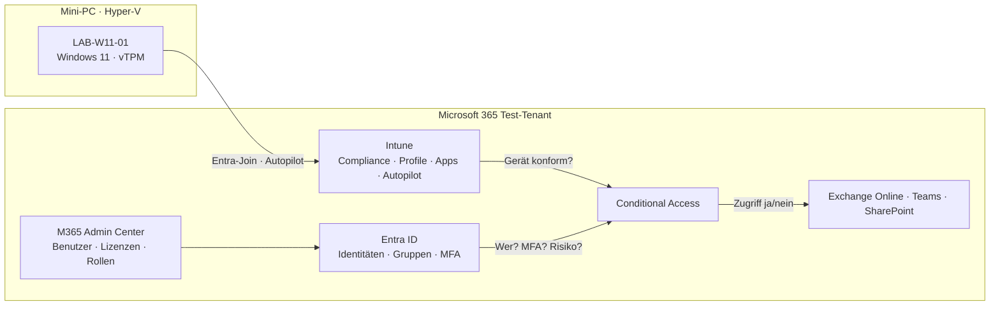
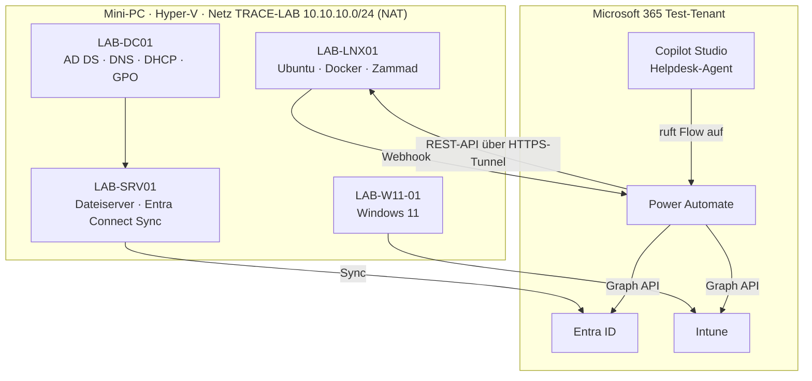

# Project: TRACE Enterprise Lab

#wichtig #lab #m365 #iam

> **Eine Planung statt zwei.** Dieses Dokument führt die beiden OneNote-Seiten
> („IT Architektur M365 und KI" und „TRACE Enterprise Lab") zu einem Bauplan zusammen.
> Was an den Ursprungsnotizen korrigiert wurde, steht in [[Doku-Review_TRACE-Lab]].
> Stand: 14.11.2026 · Status: **Planung fertig, Umsetzung noch nicht begonnen**

## 1. Ziel

**Schwerpunkt (festgelegt am 14.11.2026): M365-Administration mit Entra ID, Conditional Access und Intune.**
Alles andere ist Erweiterung und kommt erst danach.

**Zielrichtung danach: Identity Security / IAM-Automatisierung.** Der Kern ist das Fundament,
die Spezialisierung (Phasen S1–S3) baut darauf auf: Governance (IGA, PIM), Automatisierung über
Schnittstellen (Graph, SCIM, Python) und die Absicherung von KI-Agenten und Maschinen-Identitäten.

Eine kleine Firma („TRACE GmbH") als Übungsumgebung, an der ich den kompletten
Mitarbeiter-Lebenszyklus in der Microsoft-Cloud selbst durchspiele: Konto anlegen →
Lizenz und Rollen → Gerät bereitstellen → Zugriff absichern → Konto sauber stilllegen.

Drei Zwecke:

1. **Üben** – jede Phase endet mit einer Aufgabe, die ich ohne Anleitung wiederholen kann.
2. **Spezialisieren** – M365-Admin: Identität (Entra ID), Zugriff (Conditional Access), Endgeräte (Intune/Autopilot).
3. **Referenz** – jede Phase hinterlässt ein Runbook, das ich später im Job oder Kundenprojekt nachschlage und erweitere.

**Nicht-Ziele (bewusst):** kein Produktivbetrieb, keine echten Personendaten, keine Kunden- oder Arbeitgeberdaten im Lab.

## 2. Entscheidungen

| Thema | Entscheidung | Warum |
|---|---|---|
| Reihenfolge | **Cloud zuerst** (Kern), lokales AD und Hybrid danach (Erweiterung) | der Schwerpunkt liegt auf Entra ID, Conditional Access, Intune – dafür braucht es kein lokales AD |
| Geräte im Kern | **Entra-Join** (reine Cloud-Geräte), kein Hybrid-Join | heutiger Standard für neue Geräte, deutlich weniger Fehlerquellen |
| Hypervisor | **Hyper-V** auf Windows 11 Pro | kostenlos, übt gleich die Microsoft-Welt |
| RAM | **32 GB** reichen; im Kern läuft nur eine Windows-11-VM | 64 GB erst für Ausbaustufe VDI |
| Tenant-Domain | eigene Domain im Tenant verifizieren (statt nur `onmicrosoft.com`) | realistische Anmeldenamen, DNS-Einträge für Exchange üben |
| Lizenz | **Microsoft 365 Business Premium** | enthält Entra ID P1 (Conditional Access), Intune, Exchange, Teams |
| Automatisierung | PowerShell + Microsoft Graph im Kern; Power Automate/Copilot Studio als Erweiterung | erst die Verwaltung beherrschen, dann automatisieren |
| Später: AD-Domäne | `lab.<eigene-domain>`, NetBIOS `TRACE` – nicht `trace.lab` / `TRACE.LOCAL` | gleicher Anmeldename lokal und in der Cloud |
| Citrix, Workspace ONE, Wazuh, Keycloak | Ausbaustufe | Lizenz- und RAM-Fresser |

## 3. Architektur

### Kern (Schwerpunkt)



**Merksatz:** Entra ID sagt, *wer* jemand ist. Intune sagt, ob das *Gerät* in Ordnung ist.
Conditional Access entscheidet aus beidem, ob der Zugriff erlaubt wird.

### Mit Erweiterungen



## 4. Bauplan: VMs, Netz, Namen

### VMs (32 GB Host)

| VM | Rolle | vCPU | RAM | Disk | Ab Phase |
|---|---|---|---|---|---|
| LAB-W11-01 | Windows 11 Client (Gen 2, vTPM, Secure Boot) | 4 | 8 GB | 100 GB | **0 (Kern)** |
| LAB-W11-02 | zweiter Client, als „nicht konformes" Gegenbeispiel | 2 | 6 GB | 80 GB | 5 (Kern, optional) |
| LAB-DC01 | AD DS, DNS, DHCP | 2 | 4 GB | 80 GB | 7 (Erweiterung) |
| LAB-SRV01 | Dateiserver + Entra Connect Sync | 2 | 4 GB | 80 GB | 8 (Erweiterung) |
| LAB-LNX01 | Ubuntu Server, Docker, Zammad | 2 | 6 GB | 60 GB | 9 (Erweiterung) |
| Host | Windows 11 Pro + Reserve | – | 6 GB | – | – |

Im Kern laufen höchstens zwei VMs – das geht notfalls auch auf einem Laptop mit 16 GB.

### Netz

| Was | Wert |
|---|---|
| vSwitch | `TRACE-LAB` (intern) + NAT auf dem Host |
| Netz | 10.10.10.0/24, Gateway (Host) 10.10.10.1 |
| Im Kern | Clients mit fester Adresse, z. B. 10.10.10.101, DNS 9.9.9.9 |
| Ab Phase 7 | DC01 10.10.10.10 (DNS + DHCP 10.10.10.150–199), SRV01 .20, LNX01 .30 |

### Firmenstruktur TRACE GmbH

| Abteilung | Benutzer | Gruppe |
|---|---|---|
| IT | admin01, it.user01 | SG-IT |
| Personal | hr.user01 | SG-HR |
| Geschäftsleitung | ceo.user01 | SG-Management |
| Verwaltung | office.user01 | SG-Office |

Dazu im Tenant: ein **Notfall-Adminkonto** (von allen Richtlinien ausgenommen) und die
Pilotgruppe `SG-Pilot-CA` für neue Richtlinien.

## 5. Lizenzen und Kosten

| Baustein | Quelle | Laufzeit | Starten in Phase |
|---|---|---|---|
| Hyper-V, PowerShell, Graph SDK | kostenlos | – | 0 |
| Windows 11 Pro | vorhandene Lizenz bzw. Evaluation | – | 0 |
| Microsoft 365 Business Premium | Testversion, danach Monatslizenz | ca. 1 Monat Test | 1 |
| Eigene Domain | vorhanden bzw. ca. 15 €/Jahr | – | 1 |
| Windows Server 2022 | Evaluation | 180 Tage | erst 7 |
| Power Automate (Premium), Copilot Studio | Testversion | begrenzt | erst 9 |

- **Die Testversion deckt nur den ersten Monat.** Der Kern dauert rund 12 Wochen – danach eine **monatlich** kündbare Business-Premium-Lizenz für 1–2 Benutzer einplanen, kein Jahresvertrag.
- **Grenze von Business Premium:** Entra ID **P1**. Für die Spezialisierung braucht es mehr:
  - **S1:** PIM, Zugriffsüberprüfungen und risikobasierte Richtlinien brauchen **Entra ID P2**; Lebenszyklus-Workflows und erweiterte Berechtigungsverwaltung die Zusatzlizenz **Entra ID Governance**.
  - **S3:** Conditional Access für Workload-Identitäten braucht **Workload Identities Premium**; verwaltete Identitäten brauchen ein Azure-Abonnement (kostenloses Testguthaben reicht).
  - Für alle gibt es Testversionen – erst zu Beginn der jeweiligen Phase aktivieren und den genauen Lizenzzuschnitt dann bei Microsoft prüfen, er ändert sich häufig.
- Das **Microsoft 365 Developer Program** (kostenlose E5-Sandbox) gibt es nur noch für bestimmte Berechtigte. Prüfen, nicht einplanen.
- Laufzeiten und Preise vor dem Start im deutschen Microsoft-Checkout gegenprüfen – das sind Planungswerte.

## 6. Phasenplan

Jede Phase hat ein **Abnahmekriterium** (kann ich es vorführen?) und ein **Referenz-Ergebnis**
(was bleibt als Nachschlagewerk?). Erst abhaken, wenn beides da ist.

### Kern: M365-Admin mit Entra ID, Conditional Access, Intune (rund 12 Wochen)

| # | Phase | Dauer | Inhalt | Abnahme |
|---|---|---|---|---|
| 0 | Fundament | ½ Wo. | Hyper-V, Netz mit NAT, eine Windows-11-VM mit vTPM | VM kommt ins Internet |
| 1 | Tenant & M365-Admin | 1½ Wo. | Testversion, eigene Domain + DNS-Einträge, Admin Center, Benutzer, Lizenzen, Adminrollen, Exchange Online (Postfach, geteiltes Postfach), Teams, SharePoint-Rechte | neuer Mitarbeiter hat Konto, Lizenz, Postfach und Teamzugang – in einem Durchgang |
| 2 | Entra ID vertieft | 2 Wo. | Notfallkonto, Authentifizierungsmethoden und MFA, Kennwort-Selbstzurücksetzung, Sicherheitsgruppen und dynamische Gruppen, gruppenbasierte Lizenzen, Rollen nach geringstem Recht, Anmelde- und Überwachungsprotokolle, Unternehmensanwendungen (SSO) | Benutzer landet per Abteilungsmerkmal automatisch in Gruppe und bekommt Lizenz; eine fehlgeschlagene Anmeldung im Protokoll erklären |
| 3 | Intune Grundlagen | 2 Wo. | automatische MDM-Registrierung, Entra-Join, Gerätegruppen, Compliance (BitLocker, Firewall, Defender, Mindestversion), Konfigurationsprofile, Sicherheitsbaseline, Update-Ringe | Gerät zeigt „konform"; eine Einstellung ist nachweisbar angekommen |
| 4 | Autopilot & Apps | 2 Wo. | Hardware-Hash, Bereitstellungsprofil, Registrierungsstatusseite, OOBE-Durchlauf, Win32-App (.intunewin), Microsoft 365 Apps, Fehlersuche bei App-Installation | zurückgesetzte VM richtet sich ohne Handgriff ein, App ist installiert |
| 5 | Conditional Access | 2 Wo. | Aufbau einer Richtlinie (wer / was / Bedingung / Kontrolle), MFA für alle, nur konforme Geräte, alte Anmeldeverfahren sperren, strengere Regeln für Admins, benannte Standorte, Berichtsmodus, „Was wäre wenn"-Werkzeug, Pilot- und Ausschlussgruppe | nicht konformes Gerät wird abgewiesen, konformes kommt durch – im Anmeldeprotokoll belegt |
| 6 | PowerShell & Graph | 2 Wo. | Eintritt / Wechsel / Austritt als Skripte, Berichte (Lizenzen, MFA-Stand, Gerätekonformität), **Kern-Abschluss**: eine Phase nur nach eigenem Runbook wiederholen | ein Befehl legt Mitarbeiter komplett an; ein Befehl legt ihn sauber still |

Referenz-Ergebnis jeder Phase: ein Runbook nach dem Schema in Abschnitt 8.

### Spezialisierung: Identity Security & IAM-Automatisierung (rund 9 Wochen, nach dem Kern)

Baut auf dem Kern auf – ohne sicheres Entra ID und Conditional Access bleibt das hier Theorie.

| # | Phase | Dauer | Inhalt | Abnahme |
|---|---|---|---|---|
| S1 | Governance (IGA + PIM) | 3 Wo. | PIM: Adminrollen nur auf Anforderung, zeitlich begrenzt, mit Genehmigung und Begründung · Zugriffsüberprüfungen (regelmäßige Rezertifizierung von Gruppen und Rollen) · Berechtigungsverwaltung mit Zugriffspaketen (Antrag → Genehmigung → Ablauf) · Lebenszyklus-Workflows für Eintritt/Austritt · Funktionstrennung · Nachweise aus den Protokollen · Zuordnung: welche Lab-Einstellung belegt welche Anforderung aus NIS2/DORA (Zugriffskontrolle, geringstes Recht, Protokollierung, Überprüfung) | kein Konto ist dauerhaft Globaler Admin; eine Überprüfung entzieht einem Benutzer nachweisbar ein Recht; ein Zugriffspaket läuft von selbst ab |
| S2 | Automatisierung & Schnittstellen | 3 Wo. | Graph direkt per REST (nicht nur über Cmdlets) · App-Registrierung, delegierte vs. Anwendungsberechtigung, Zertifikat statt Geheimnis · dasselbe in **Python** · **SCIM**: automatische Benutzerbereitstellung von Entra ID in eine Fremdanwendung (Testendpunkt), Attributzuordnung, Bereitstellungsprotokoll · API-gesteuerte Bereitstellung aus einer „Personalquelle" (CSV als HR-Ersatz) | Zeile in der Personal-CSV → Benutzer entsteht in Entra ID → erscheint per SCIM in der Zielanwendung; Austritt entfernt ihn dort wieder |
| S3 | Maschinen-Identitäten & KI-Agenten | 3 Wo. | App-Registrierung vs. Dienstprinzipal vs. verwaltete Identität · Bestandsaufnahme: welche Apps haben welche Rechte, wem gehören sie, wann laufen Geheimnisse ab · Verbundanmeldung ohne Geheimnis (GitHub Actions → Entra ID per OIDC) · geringstes Recht bei Graph-Berechtigungen, Zustimmung der Benutzer einschränken · Conditional Access für Workload-Identitäten · Identität und Rechte von KI-Agenten (Copilot Studio, eigener Agent aus dem AI-OS): eigene Identität je Agent, enger Rechteumfang, Protokoll, menschliche Freigabe | Bericht über alle Apps mit Rechten, Besitzer und Ablaufdatum; eine Pipeline meldet sich ohne gespeichertes Geheimnis an; ein Agent kann nachweisbar nur das, was er soll |

Reihenfolge: S1 → S2 → S3. S3 hängt eng mit Phase 9 (Copilot-Studio-Agent) zusammen und lässt sich mit ihr verbinden.

Einordnung: „Klick-Admins werden ersetzt" ist zugespitzt – die Portale bleiben, und wer sie nicht
versteht, automatisiert das Falsche. Die Richtung stimmt aber: Gefragt ist, wer Verwaltung,
Governance und Automatisierung zusammenbringt. NIS2/DORA sind hier als Lernbezug gedacht, keine
Rechtsberatung – die konkreten Pflichten hängen vom jeweiligen Unternehmen ab.

### Erweiterung (einzeln, nach dem Kern)

| # | Phase | Dauer | Inhalt | Abnahme |
|---|---|---|---|---|
| 7 | Active Directory | 1½ Wo. | DC01, DNS, DHCP, OUs, Gruppen, Kennwortrichtlinie, GPO | Benutzer anlegen → Anmeldung am Domänen-Client |
| 8 | Hybrid Identity | 1 Wo. | SRV01, Entra Connect Sync, OU-Filter, Anmeldename prüfen | AD-Benutzer erscheint in Entra ID |
| 9 | Helpdesk-Automatisierung | 3 Wo. | Zammad, SSO, Power Automate, Copilot-Studio-Agent in Teams | Agent legt Ticket an und nennt Status |
| 10 | Gesamtabschluss | 1 Wo. | Gesamtdoku, Portfolio-Text | – |

### Die drei Helpdesk-Fälle (Phase 9)

| Fall | Ablauf | Schwierigkeit |
|---|---|---|
| **A – Ticket anlegen** | Mitarbeiter schreibt in Teams → Agent sucht in SharePoint-Wissensbasis → keine Lösung → Flow legt Zammad-Ticket an → Ticketnummer zurück | zuerst bauen |
| **B – Status abfragen** | „Wie steht Ticket 1042?" → Flow fragt Zammad ab → Status + letzte Notiz im Chat | danach |
| **C – Standardticket selbst erledigen** | Zammad meldet neues Ticket per Webhook → Flow → Agent ordnet ein → Graph weist z. B. App in Intune zu → Ticket wird geschlossen | zuletzt, **immer mit Freigabeschritt** |

Regeln für Fall C: nur eine feste Liste harmloser Aktionen, vor jeder Änderung eine
Genehmigung in Teams, jede Aktion wird im Ticket protokolliert.

## 7. Stolpersteine, die ich vorher kennen sollte

Kern:

1. **Notfall-Adminkonto vor der ersten Conditional-Access-Richtlinie** anlegen und von allen Richtlinien ausschließen, sonst sperre ich mich aus dem Tenant aus.
2. **Sicherheitsstandards (Security Defaults) und Conditional Access schließen sich aus.** Vor der ersten eigenen Richtlinie die Standards abschalten – und in derselben Sitzung die MFA-Richtlinie aktivieren.
3. **Neue Richtlinie immer erst im Berichtsmodus** und nur für die Pilotgruppe, dann im Anmeldeprotokoll ansehen, dann scharf.
4. **„Nur konforme Geräte" erst, wenn es ein konformes Gerät gibt** – also nach Phase 3, nicht vorher.
5. **Compliance braucht Zeit:** Ein frisch registriertes Gerät ist erst nach der ersten Auswertung konform. Nicht sofort einen Fehler vermuten.
6. **Autopilot in der VM** geht zum Üben (Gen 2, vTPM, Secure Boot). Für das echte Verhalten später ein altes physisches Gerät nehmen – nie den Arbeits-PC zurücksetzen.
7. **Mit dem Adminkonto wird nicht gearbeitet.** Getrennte Konten für Verwaltung und Alltag, schon im Lab.
8. **Prüfpunkt der VM vor jedem Autopilot-Zurücksetzen.**

Erweiterung:

9. **Power Automate erreicht das Lab-Netz nicht.** Zammad braucht einen HTTPS-Tunnel (Cloudflare Tunnel ist bei mir schon im Einsatz) oder das Datengateway. Nie unverschlüsselt, nie ohne Token.
10. **HTTP-Aktion in Power Automate ist ein Premium-Konnektor.**
11. **API-Token gehören nicht in Notizen oder Git** – Ablage in `01_Verbindungen/APIs/Geheimnisse/`.
12. **Sync nicht mit allem starten:** erst eine Test-OU synchronisieren.

## 8. So wird das Lab zur Referenz

```
M365 und KI Copilot mit Powerautomate/
├── Project_TRACE-Enterprise-Lab.md   ← dieser Plan
├── Doku-Review_TRACE-Lab.md          ← was an den Notizen korrigiert wurde
├── Runbooks/                         ← je Phase eine Datei
├── Skripte/                          ← PowerShell, exportierte Flows (ohne Geheimnisse)
└── IT Projekt M365 und KI/           ← OneNote-Rohnotizen (Ideen, Screenshots)
```

**Runbook-Schema** (immer gleich, damit ich später schnell finde):

1. Ziel in einem Satz
2. Voraussetzungen
3. Schritte (Klickweg oder Befehl + eine Zeile *warum*)
4. Prüfung: woran sehe ich, dass es funktioniert?
5. Fehlerbilder, die mir wirklich passiert sind, und die Lösung
6. Bezug zur Praxis: wo begegnet mir das im Job?

Arbeitsteilung: **OneNote** = schnelle Notizen und Screenshots während des Bauens,
**Markdown hier** = bereinigte, wiederverwendbare Fassung. Fertige Runbooks können später
in die IT-Werkbank übernommen werden.

## 9. Ausbaustufen (nach Phase 10, einzeln wählbar)

| Stufe | Inhalt | Voraussetzung |
|---|---|---|
| A – Mobilgeräte | Android/iOS in Intune, App-Schutzrichtlinien ohne Geräteregistrierung | Testgerät |
| B – Zweiter Identitätsanbieter | Keycloak als Vergleich und als SCIM-/OIDC-Gegenstelle | S2 |
| C – VDI | RDS-Sitzungshost + FSLogix-Profile | 64 GB RAM empfohlen |
| D – Citrix / Workspace ONE | zweites Bereitstellungs- bzw. Verwaltungssystem | Testlizenzen |
| E – Sicherheitsüberwachung | Wazuh auf LNX01 | mehr RAM |
| F – KI-Berechtigungsassistent | Agent liest Gruppen/Rechte, schlägt Bereinigung vor, Mensch gibt frei; Anbindung an AI-OS | Phase 6 |
| G – Server 2025 | Upgrade oder zweiter DC als Migrationsübung | Phase 7 |

## 10. Offene Punkte vor Phase 0

- [ ] Mini-PC: Betriebssystem (Win 11 Pro?), Prozessor, Größe der internen SSD
- [ ] Welche eigene Domain kommt in den Tenant?
- [ ] Ist ein altes physisches Windows-Gerät für den späteren Autopilot-Echttest vorhanden?
- [ ] Startdatum festlegen – die Testversion erst an diesem Tag aktivieren

## 11. Fortschritt

| Phase | Status | Begonnen | Abgenommen | Runbook |
|---|---|---|---|---|
| 0 Fundament | offen | | | [[Phase-0_Fundament]] (Entwurf) |
| 1 Tenant & M365-Admin | offen | | | |
| 2 Entra ID vertieft | offen | | | |
| 3 Intune Grundlagen | offen | | | |
| 4 Autopilot & Apps | offen | | | |
| 5 Conditional Access | offen | | | |
| 6 PowerShell & Graph | offen | | | |
| S1 Governance (IGA + PIM) | offen | | | |
| S2 Automatisierung & Schnittstellen | offen | | | |
| S3 Maschinen-Identitäten & KI-Agenten | offen | | | |
| 7 Active Directory (Erw.) | offen | | | [[Phase-7_Active-Directory]] (Entwurf) |
| 8 Hybrid Identity (Erw.) | offen | | | |
| 9 Helpdesk-Automatisierung (Erw.) | offen | | | |
| 10 Gesamtabschluss | offen | | | |
