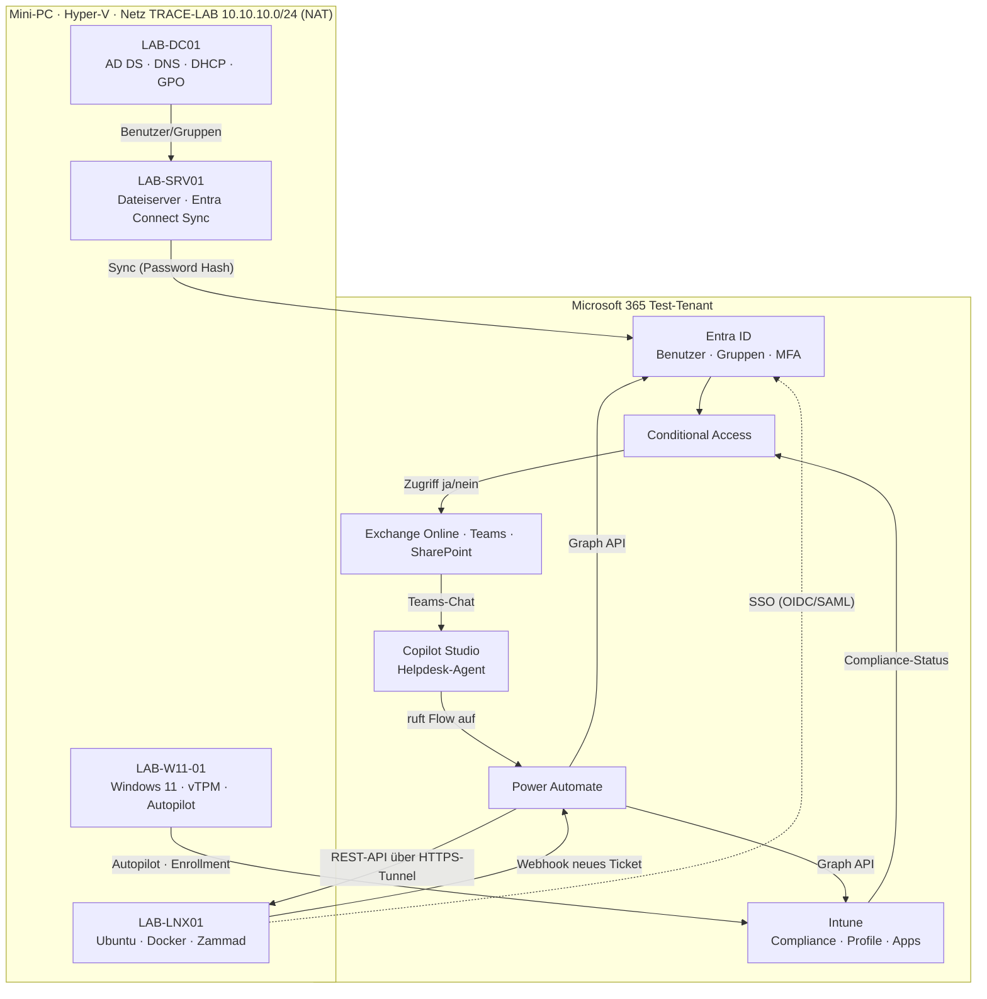

# Project: TRACE Enterprise Lab

#wichtig #lab #m365 #iam

> **Eine Planung statt zwei.** Dieses Dokument führt die beiden OneNote-Seiten
> („IT Architektur M365 und KI" und „TRACE Enterprise Lab") zu einem Bauplan zusammen.
> Was an den Ursprungsnotizen korrigiert wurde, steht in [[Doku-Review_TRACE-Lab]].
> Stand: 14.11.2026 · Status: **Planung fertig, Umsetzung noch nicht begonnen**

## 1. Ziel

Eine kleine Firma („TRACE GmbH") als Übungsumgebung, an der ich den kompletten
Mitarbeiter-Lebenszyklus selbst durchspiele: Konto anlegen → Gerät bereitstellen →
Zugriff absichern → Ticket bearbeiten → Konto sauber stilllegen.

Drei Zwecke, in dieser Reihenfolge:

1. **Üben** – jede Phase endet mit einer Aufgabe, die ich ohne Anleitung wiederholen kann.
2. **Spezialisieren** – Schwerpunkt Identität (AD/Entra), Endgeräte (Intune/Autopilot), Automatisierung (PowerShell/Graph, Power Automate, Copilot Studio).
3. **Referenz** – jede Phase hinterlässt ein Runbook, das ich später im Job oder Kundenprojekt nachschlage und erweitere.

**Nicht-Ziele (bewusst):** kein Produktivbetrieb, keine echten Personendaten, keine Kunden- oder Arbeitgeberdaten im Lab, kein Citrix/Workspace ONE im Kern (erst Ausbaustufe).

## 2. Entscheidungen (waren in den Notizen widersprüchlich)

| Thema | Entscheidung | Warum |
|---|---|---|
| Hypervisor | **Hyper-V** auf Windows 11 Pro | kostenlos, übt gleich die Microsoft-Welt; Proxmox nur falls der Mini-PC kein Win 11 Pro hat |
| RAM-Basis | **32 GB** (vorhanden), 64 GB erst für Ausbaustufe VDI | Kern-Lab läuft mit 32 GB, wenn nicht alle VMs gleichzeitig laufen |
| Server-Version | **Windows Server 2022** Evaluation (180 Tage) | breiteste Verbreitung; 2025 später als Upgrade-Übung |
| AD-Domäne | **`lab.<eigene-domain>`**, NetBIOS `TRACE` – *nicht* `trace.lab` / `TRACE.LOCAL` | Subdomain einer eigenen, im Tenant verifizierbaren Domain → gleicher UPN lokal und in der Cloud, Hybrid funktioniert ohne Umbau |
| Ticketsystem | **Zammad** (Docker) | Open Source, gute REST-API, Webhooks |
| Automatisierung Kern | **Power Automate + Copilot Studio** | das ist der M365-Lernschwerpunkt; n8n/Node-RED nur Ausbaustufe |
| Citrix, Workspace ONE, Wazuh, Keycloak | **Ausbaustufe**, nicht Kern | Lizenz- und RAM-Fresser, lenken vom Kern ab |
| Reihenfolge | **erst lokal, dann Cloud** | Testlizenzen laufen ab Aktivierung – Tenant erst starten, wenn AD steht |

## 3. Architektur



**Merksatz zur Zugriffskontrolle:** Die Geräte-Compliance kommt aus Intune, nicht aus
der Synchronisierung. Entra ID *verwendet* sie nur bei der Conditional-Access-Entscheidung.

## 4. Bauplan: VMs, Netz, Namen

### VMs (32 GB Host)

| VM | Rolle | vCPU | RAM | Disk | Ab Phase |
|---|---|---|---|---|---|
| LAB-DC01 | AD DS, DNS, DHCP | 2 | 4 GB | 80 GB | 1 |
| LAB-W11-01 | Windows 11 Client (Gen 2, vTPM, Secure Boot) | 4 | 6–8 GB dyn. | 100 GB | 1 |
| LAB-SRV01 | Dateiserver + Entra Connect Sync | 2 | 4 GB | 80 GB | 3 |
| LAB-LNX01 | Ubuntu Server, Docker, Portainer, Zammad | 2 | 6 GB | 60 GB | 8 |
| LAB-W11-02 | zweiter Client (nur bei Bedarf) | 2 | 6 GB | 80 GB | optional |
| Host | Windows 11 Pro + Reserve | – | 6 GB | – | – |

Summe Kern: 26–28 GB. **Regel:** LAB-W11-02 nur starten, wenn LAB-LNX01 aus ist.
Entra Connect gehört nicht auf den Domänencontroller – deshalb liegt es auf SRV01.
Zammad braucht wegen Elasticsearch mehr RAM als die ursprünglich notierten 4 GB.

### Netz

| Was | Wert |
|---|---|
| vSwitch | `TRACE-LAB` (intern) + NAT auf dem Host |
| Netz | 10.10.10.0/24 |
| Gateway (Host) | 10.10.10.1 |
| LAB-DC01 | 10.10.10.10 (zugleich DNS für alle Lab-Geräte) |
| LAB-SRV01 | 10.10.10.20 |
| LAB-LNX01 | 10.10.10.30 |
| DHCP-Bereich (Clients) | 10.10.10.150–199 |
| DNS-Weiterleitung | DC01 leitet externe Anfragen weiter |

### Firmenstruktur TRACE GmbH

| Abteilung | Benutzer | Gruppe |
|---|---|---|
| IT | admin01, it.user01 | SG-IT |
| Personal | hr.user01 | SG-HR |
| Geschäftsleitung | ceo.user01 | SG-Management |
| Verwaltung | office.user01 | SG-Office |

```
lab.<eigene-domain>
└── TRACE
    ├── Benutzer      (IT · HR · Management · Office)
    ├── Computer      (Workstations · Server)
    ├── Gruppen       (Sicherheit · Verteiler)
    └── Dienstkonten
```

Eine eigene Ober-OU `TRACE` statt der Standardcontainer `Users`/`Computers`: nur auf
OUs lassen sich Gruppenrichtlinien verknüpfen und nur OUs lassen sich gezielt synchronisieren.

## 5. Lizenzen und Kosten

| Baustein | Quelle | Laufzeit | Starten in Phase |
|---|---|---|---|
| Hyper-V, PowerShell, Graph SDK | kostenlos | – | 0 |
| Windows Server 2022 | Evaluation | 180 Tage | 1 |
| Windows 11 Pro | vorhandene Lizenz bzw. Evaluation | – | 1 |
| Microsoft 365 Business Premium (Entra ID P1, Intune, Exchange, Teams) | Testversion | ca. 1 Monat | **erst 2** |
| Power Automate (Premium-Konnektor HTTP) | Testversion | begrenzt | **erst 8** |
| Copilot Studio | Testversion | begrenzt | **erst 8** |
| Eigene Domain für UPN | vorhanden bzw. ca. 15 €/Jahr | – | 2 |

- **Testuhren laufen ab Aktivierung.** Deshalb Tenant erst nach Phase 1, Power Automate/Copilot Studio erst in Phase 8.
- Das **Microsoft 365 Developer Program** (kostenlose E5-Sandbox) gibt es nur noch für bestimmte Berechtigte (z. B. Visual-Studio-Abonnenten). Nicht fest einplanen, nur prüfen.
- Nach Ablauf der Testversion: **monatlich** kündbare Lizenz für 1–2 Benutzer, kein Jahresvertrag. Budgetrahmen gesamt: **0–100 €**.
- Laufzeiten und Preise vor dem Start im deutschen Microsoft-Checkout gegenprüfen – das sind Planungswerte.

## 6. Phasenplan

Jede Phase hat ein **Abnahmekriterium** (kann ich es vorführen?) und ein **Referenz-Ergebnis**
(was bleibt als Nachschlagewerk?). Erst abhaken, wenn beides da ist.

| # | Phase | Dauer | Abnahme | Referenz-Ergebnis |
|---|---|---|---|---|
| 0 | Fundament: Host, Hyper-V, vSwitch + NAT, Ordner, Prüfpunkt-Regel | ½ Wo. | VM im Lab-Netz kommt ins Internet, Heimnetz unverändert | Runbook „Lab-Host aufsetzen" |
| 1 | Active Directory: DC01, DNS, DHCP, OUs, 5 Benutzer, Gruppen, Kennwortrichtlinie der Domäne, GPO Bildschirmsperre, W11-01 in Domäne | 1½ Wo. | neuer Benutzer → Gruppe → Anmeldung am Client klappt | Runbook „Domäne + Benutzeranlage", PowerShell-Skript Benutzeranlage |
| 2 | Tenant & Entra ID: Testversion, eigene Domain verifizieren, Notfall-Adminkonto, MFA, Rollen, Gruppen, Lizenzzuweisung, Exchange/SharePoint-Grundlagen | 1 Wo. | Cloud-Benutzer mit MFA meldet sich an, hat Postfach | Runbook „Tenant-Grundabsicherung" |
| 3 | Hybrid Identity: SRV01, Entra Connect Sync, OU-Filter, UPN prüfen, Dateifreigaben mit Gruppenrechten | 1 Wo. | AD-Benutzer erscheint in Entra ID und meldet sich mit gleichem UPN an | Runbook „Sync einrichten + Fehlerbilder" |
| 4 | Intune Grundlagen: automatische MDM-Registrierung, Gerätegruppen, Compliance (BitLocker, Firewall, Defender), Konfigurationsprofile, Update-Ringe | 2 Wo. | Gerät zeigt „konform", Richtlinie nachweisbar angekommen | Runbook „Compliance + Baseline" |
| 5 | Autopilot & Apps: Hardware-Hash, Bereitstellungsprofil, OOBE-Durchlauf, Win32-App (.intunewin), M365 Apps | 2 Wo. | zurückgesetzte VM richtet sich ohne Handgriff ein, App ist installiert | Runbook „Autopilot von Hash bis Desktop", Fehlerkatalog App-Installation |
| 6 | Conditional Access: MFA-Pflicht, nur konforme Geräte, Pilot- und Ausschlussgruppe, erst „Nur Bericht" dann scharf | 1 Wo. | nicht konformes Gerät wird abgewiesen, konformes kommt durch – im Anmeldeprotokoll belegt | Runbook „CA-Richtlinien sicher einführen" |
| 7 | Automatisierung mit PowerShell & Graph: Eintritt / Wechsel / Austritt als Skripte, Berichte als CSV | 2 Wo. | ein Befehl legt Mitarbeiter komplett an; ein Befehl legt ihn sauber still | Skriptsammlung + Runbook „Joiner/Mover/Leaver" |
| 8 | Helpdesk-Automatisierung: LNX01, Zammad, SSO mit Entra ID, HTTPS-Zugang für Power Automate, Flows, Copilot-Studio-Agent in Teams (Fälle A/B/C, siehe unten) | 3 Wo. | Agent beantwortet Frage aus Wissensbasis, legt Ticket an, nennt Ticketstatus | Runbook „Zammad ↔ Power Automate ↔ Copilot Studio", exportierte Flows |
| 9 | Abschluss: Gesamtdoku, Architekturdiagramm aktualisieren, Wiederaufbau-Test einer VM aus Runbook, Portfolio-Text | 1 Wo. | eine Phase gelingt nur anhand des eigenen Runbooks | Portfolio-Seite, bereinigte Runbooks |

Gesamt: rund **15 Wochen** bei Abendarbeit. Die ursprünglichen „12 Wochen" enthielten Zammad/Copilot Studio nicht.

### Die drei Helpdesk-Fälle (Phase 8)

| Fall | Ablauf | Schwierigkeit |
|---|---|---|
| **A – Ticket anlegen** | Mitarbeiter schreibt in Teams → Agent sucht in SharePoint-Wissensbasis → keine Lösung → Flow legt Zammad-Ticket an → Ticketnummer zurück | zuerst bauen |
| **B – Status abfragen** | „Wie steht Ticket 1042?" → Flow fragt Zammad ab → Status + letzte Notiz im Chat | danach |
| **C – Standardticket selbst erledigen** | Zammad meldet neues Ticket per Webhook → Flow → Agent ordnet ein → Graph weist z. B. App in Intune zu → Ticket wird geschlossen | zuletzt, **immer mit Freigabeschritt** |

Regeln für Fall C: nur eine feste Liste harmloser Aktionen (z. B. App zuweisen), vor jeder
Änderung eine Genehmigung in Teams, jede Aktion wird im Ticket protokolliert. Kein Flow
ändert Konten oder Rechte ohne menschliches Ja.

## 7. Stolpersteine, die ich vorher kennen sollte

1. **Power Automate erreicht das Lab-Netz nicht.** Die Flows laufen in der Cloud, `http://10.10.10.30` ist von dort unsichtbar. Lösung: Zammad über einen HTTPS-Tunnel (Cloudflare Tunnel ist bei mir schon im Einsatz) oder das On-Premises-Datengateway veröffentlichen. Nie unverschlüsselt und nie ohne Token.
2. **HTTP-Aktion in Power Automate ist ein Premium-Konnektor** – braucht Testversion oder Lizenz.
3. **Notfall-Adminkonto vor der ersten Conditional-Access-Richtlinie** anlegen und von den Richtlinien ausschließen, sonst sperre ich mich aus dem Tenant aus.
4. **Autopilot in der VM** geht zum Üben (Gen 2, vTPM, Secure Boot). Für das echte Verhalten später ein altes physisches Gerät nehmen – nie den Arbeits-PC zurücksetzen.
5. **API-Token gehören nicht in Notizen oder Git.** Ablage nach AI-OS-Regel in `01_Verbindungen/APIs/Geheimnisse/`.
6. **Prüfpunkt vor jedem größeren Schritt** (vor Domänenaufnahme, vor Sync, vor CA). Spart den Neuaufbau.
7. **Evaluation läuft ab:** Datum der Server-Installation notieren, Restlaufzeit mit `slmgr /dlv` prüfen.
8. **Sync nicht mit allem starten:** erst eine Test-OU synchronisieren, dann erweitern.

## 8. So wird das Lab zur Referenz

Ordnerstruktur neben diesem Dokument (wächst mit den Phasen, nichts vorab anlegen):

```
M365 und KI Copilot mit Powerautomate/
├── Project_TRACE-Enterprise-Lab.md   ← dieser Plan
├── Doku-Review_TRACE-Lab.md          ← was an den Notizen korrigiert wurde
├── Runbooks/                         ← je Phase eine Datei: Phase-1_Active-Directory.md …
├── Skripte/                          ← PowerShell, exportierte Flows (ohne Geheimnisse)
└── IT Projekt M365 und KI/           ← OneNote-Rohnotizen (Ideen, Screenshots)
```

**Runbook-Schema** (immer gleich, damit ich später schnell finde):

1. Ziel in einem Satz
2. Voraussetzungen
3. Schritte (Befehl + eine Zeile *warum*)
4. Prüfung: woran sehe ich, dass es funktioniert?
5. Fehlerbilder, die mir wirklich passiert sind, und die Lösung
6. Bezug zur Praxis: wo begegnet mir das im Job?

Arbeitsteilung: **OneNote** = schnelle Notizen und Screenshots während des Bauens,
**Markdown hier** = bereinigte, wiederverwendbare Fassung. Fertige Runbooks können später
in die IT-Werkbank übernommen werden.

## 9. Ausbaustufen (nach Phase 9, einzeln wählbar)

| Stufe | Inhalt | Voraussetzung |
|---|---|---|
| A – VDI | RDS-Sitzungshost + FSLogix-Profile auf SRV01-Freigabe | 64 GB RAM empfohlen |
| B – Citrix | Citrix Virtual Apps and Desktops | Testlizenz, Stufe A |
| C – Zweites UEM | Omnissa Workspace ONE neben Intune | Testzugang |
| D – Sicherheitsüberwachung | Wazuh auf LNX01, Agenten auf DC und Client | mehr RAM für LNX01 |
| E – Zweiter Identitätsanbieter | Keycloak als Vergleich zu Entra ID | – |
| F – KI-Berechtigungsassistent | Agent liest Gruppen/Rechte, schlägt Bereinigung vor, Mensch gibt frei; Anbindung an AI-OS (lokales Modell) | Phase 7 |
| G – Server 2025 | In-Place-Upgrade oder zweiter DC als Migrationsübung | – |

## 10. Offene Punkte vor Phase 0

- [ ] Mini-PC: Betriebssystem (Win 11 Pro?), Prozessor, Größe der internen SSD
- [ ] Welche eigene Domain für `lab.<eigene-domain>` und den Cloud-UPN?
- [ ] Ist ein altes physisches Windows-Gerät für den späteren Autopilot-Echttest vorhanden?
- [ ] Startdatum festlegen (danach Wochen im Phasenplan mit Kalenderdaten versehen)

## 11. Fortschritt

| Phase | Status | Begonnen | Abgenommen | Runbook |
|---|---|---|---|---|
| 0 Fundament | offen | | | [[Phase-0_Fundament]] (Entwurf) |
| 1 Active Directory | offen | | | [[Phase-1_Active-Directory]] (Entwurf) |
| 2 Tenant & Entra ID | offen | | | |
| 3 Hybrid Identity | offen | | | |
| 4 Intune | offen | | | |
| 5 Autopilot & Apps | offen | | | |
| 6 Conditional Access | offen | | | |
| 7 PowerShell & Graph | offen | | | |
| 8 Helpdesk-Automatisierung | offen | | | |
| 9 Abschluss | offen | | | |