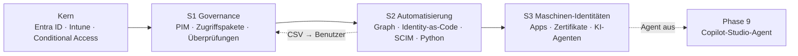

# Spezialisierung: Identity Security & IAM-Automatisierung

#lab #iam #governance

Detailblatt zu den Phasen S1–S3 in [[Project_TRACE-Enterprise-Lab]]. Es übersetzt jedes
Thema in eine **konkrete Übung im Lab** mit Abnahme. Voraussetzung: Kern (Phasen 0–6) ist abgenommen.

Stand: 14.11.2026 · Lizenzangaben sind Planungswerte, vor Phasenbeginn bei Microsoft prüfen.

## S1 – Governance & Compliance (IGA + PIM)

Leitfrage von NIS2 und DORA, auf Identitäten bezogen: **Wer hat warum Zugriff – und wer hat das wann bestätigt?**
Jede Übung unten liefert einen Teil dieses Nachweises.

| Thema | Übung im Lab | Abnahme | Lizenz |
|---|---|---|---|
| **PIM** (Adminrechte nur auf Zeit) | `admin01` ist für „Globaler Administrator" und „Intune-Administrator" nur *berechtigt*, nicht dauerhaft zugewiesen. Aktivierung: höchstens 2 Stunden, mit MFA und Begründung; für Globalen Admin zusätzlich Genehmigung. | Rolle aktivieren, arbeiten, Ablauf abwarten – danach ist das Recht weg; Aktivierung steht mit Begründung im Protokoll | Entra ID P2 |
| **Zugriffspakete** | Paket „Buchhaltung Basis": Gruppe + SharePoint-Seite + Teams-Team. `office.user01` beantragt es im Portal *Mein Zugriff*, `ceo.user01` genehmigt, Ablauf nach 30 Tagen. | Antrag → Genehmigung → Zugriff da → nach Ablauf von selbst weg | P2 bzw. Entra ID Governance |
| **Zugriffsüberprüfungen** | Vierteljährliche Überprüfung der Gruppe `SG-Management` und aller Gastkonten. Einstellung: keine Antwort = Zugriff entfernen. Ein Gastkonto dafür eigens anlegen. | Prüfer lehnt ein Mitglied ab → Mitgliedschaft wird automatisch entfernt; Ergebnisbericht exportiert | P2 bzw. Entra ID Governance |
| **Lebenszyklus-Workflows** | Kein echtes HR-System nötig: Die Workflows reagieren auf die Benutzerattribute *Einstellungsdatum* und *Austrittsdatum*. Eintritt: Gruppen + Begrüßungsmail. Austritt am letzten Tag: Konto sperren, Gruppen und Lizenzen entfernen. | Austrittsdatum auf heute setzen → Workflow läuft → Konto gesperrt, Lizenz frei | Entra ID Governance |
| **Funktionstrennung** | Zwei Zugriffspakete als unvereinbar markieren (z. B. „Rechnung anlegen" und „Rechnung freigeben"). | zweiter Antrag wird abgelehnt | Entra ID Governance |
| **Nachweis-Mappe** | Tabelle: Anforderung (Zugriffskontrolle, geringstes Recht, Protokollierung, regelmäßige Überprüfung) → welche Lab-Einstellung → welcher Bericht belegt es. | Mappe mit vier belegten Zeilen | – |

Wichtige Korrektur zur Aussage „dauerhafte Admin-Konten komplett abschaffen":
**Die Notfallkonten bleiben dauerhaft Globaler Admin.** Sie sind die bewusste Ausnahme, damit man bei
einem Ausfall von MFA oder PIM noch in den Tenant kommt – dafür streng überwacht und nie im Alltag benutzt.

Zur Anbindung von SAP SuccessFactors oder Workday: Im Lab nicht verfügbar. Ersatz ist die
API-gesteuerte Bereitstellung aus einer CSV-Datei (siehe S2) – das Prinzip ist dasselbe.

## S2 – Automatisierung & Schnittstellen

| Thema | Übung im Lab | Abnahme | Lizenz |
|---|---|---|---|
| **Graph mit PowerShell** | Mit dem Modul `Microsoft.Graph` drei Berichte bauen: Lizenzbelegung, MFA-Stand je Benutzer, Konten ohne Anmeldung seit 90 Tagen. Die inaktiven Konten erst nur *melden*, dann nach Sichtprüfung sperren. | drei CSV-Berichte; ein inaktives Testkonto wird gesperrt, nicht gelöscht | Kern |
| **Graph direkt (REST)** | Dieselbe Abfrage ohne Cmdlet: Token holen, `GET /users` aufrufen, Seitenumbruch (`@odata.nextLink`) verarbeiten. | man kann erklären, was ein Cmdlet im Hintergrund tut | Kern |
| **Identity-as-Code** | Die Conditional-Access-Richtlinien aus Phase 5 als Dateien exportieren und in ein **privates** Git-Repository legen. Eine Änderung nur noch über die Datei machen und einspielen. Werkzeug: Microsoft365DSC *oder* Terraform – eines wählen, nicht beide. | Richtlinie im Portal versehentlich ändern → aus Git wiederherstellen; Änderungsverlauf zeigt wer/was/wann | Kern |
| **SCIM** | Entra ID stellt Benutzer automatisch in einer Fremdanwendung bereit. Im Lab: ein SCIM-Testendpunkt (Microsofts Referenzcode oder eine Anwendung mit SCIM-Testzugang). Attribute zuordnen, Bereich auf eine Gruppe begrenzen. | Benutzer in Gruppe → erscheint im Ziel; aus Gruppe entfernt → wird im Ziel deaktiviert; Bereitstellungsprotokoll gelesen | P1 |
| **API-gesteuerte Bereitstellung** | CSV als „Personalsystem": Skript schickt neue Zeilen an die Bereitstellungs-Schnittstelle von Entra ID. | neue Zeile → Benutzer entsteht mit Abteilung und Einstellungsdatum → Lebenszyklus-Workflow aus S1 greift | P1 |
| **Python** | Anmeldeprotokolle per Graph abrufen und auswerten: fehlgeschlagene Anmeldungen je Benutzer, Anmeldungen aus neuen Ländern, Anmeldungen außerhalb der Arbeitszeit. | Skript liefert eine Liste auffälliger Anmeldungen aus den eigenen Lab-Daten | Kern (Protokolle 30 Tage mit P1) |

Regel für alle Skripte: Anmeldung der Automatisierung mit **Zertifikat**, nie mit Kennwort im
Skript. Keine Geheimnisse und keine Tenant-Kennungen ins Git.

## S3 – KI-Agenten & Maschinen-Identitäten

Begriffe zuerst, sie werden ständig verwechselt:

| Begriff | Was es ist |
|---|---|
| App-Registrierung | der Bauplan einer Anwendung (einmal, im Heimat-Tenant) |
| Dienstprinzipal | die Anwendung als Identität *in einem* Tenant – daran hängen die Rechte |
| Verwaltete Identität | Dienstprinzipal, dessen Anmeldedaten Azure selbst verwaltet – kein Geheimnis in eigener Hand |
| Workload-Identität | Oberbegriff für alle drei: Identitäten für Software statt für Menschen |

| Thema | Übung im Lab | Abnahme | Lizenz |
|---|---|---|---|
| **Bestandsaufnahme** | Bericht über alle App-Registrierungen und Dienstprinzipale: Rechte, Besitzer, Ablaufdatum der Geheimnisse/Zertifikate, letzte Anmeldung. | Liste zeigt jede App ohne Besitzer und jedes Geheimnis, das in 30 Tagen abläuft | Kern |
| **Geringstes Recht** | Die Berichts-App aus S2 von einer breiten Berechtigung (alles lesen/schreiben) auf genau die benötigten Leserechte zurückbauen. Benutzerzustimmung für Apps einschränken, Admin-Genehmigungsablauf einschalten. | App läuft weiter; ein Schreibversuch wird abgelehnt | Kern |
| **Zertifikat statt Geheimnis** | Geheimnis der App durch Zertifikat ersetzen, Geheimnis löschen. | Anmeldung nur noch per Zertifikat | Kern |
| **Verbundanmeldung ohne Geheimnis** | GitHub Actions meldet sich per OIDC an Entra ID an und führt einen Bericht aus – im Repository liegt kein Geheimnis. | Pipeline läuft; in den Repository-Einstellungen ist kein Kennwort hinterlegt | Kern |
| **Conditional Access für Workload-Identitäten** | Die App darf sich nur von der eigenen festen IP-Adresse anmelden. | Anmeldung von anderer Adresse wird blockiert und steht im Protokoll | Workload Identities Premium |
| **Governance für KI-Agenten** | Für den Copilot-Studio-Agenten (Phase 9) und einen Agenten aus dem AI-OS: je eigene Identität, ein benannter menschlicher Verantwortlicher, Zugriff nur auf *eine* SharePoint-Seite, Protokoll der Aktionen, Abschaltregel bei Nichtnutzung. | Steckbrief je Agent (Zweck, Verantwortlicher, Rechte, Ablaufdatum); Agent kommt nachweisbar nicht an fremde Daten | je nach Stand |

Einschränkungen, die man kennen sollte:

- Conditional Access für Workload-Identitäten gilt nach meinem Stand nur für Dienstprinzipale im eigenen Tenant, **nicht** für verwaltete Identitäten. Vor der Übung nachlesen.
- **Entra Agent ID** ist neu und im Wandel. Vor S3 den aktuellen Stand und die Lizenz prüfen; die Übung funktioniert notfalls auch mit gewöhnlichen Dienstprinzipalen.
- Die Zahl „20- bis 50-mal mehr technische als menschliche Konten" ist eine verbreitete Herstellerangabe, kein geprüfter Wert. Für das eigene Lab zählt die Bestandsaufnahme oben.

## Reihenfolge und Zusammenhang

Was daraus fürs Portfolio entsteht: eine Nachweis-Mappe (S1), ein Git-Repository mit
Richtlinien als Code und Skripten (S2) und Steckbriefe samt Bestandsbericht für technische
Identitäten (S3).
