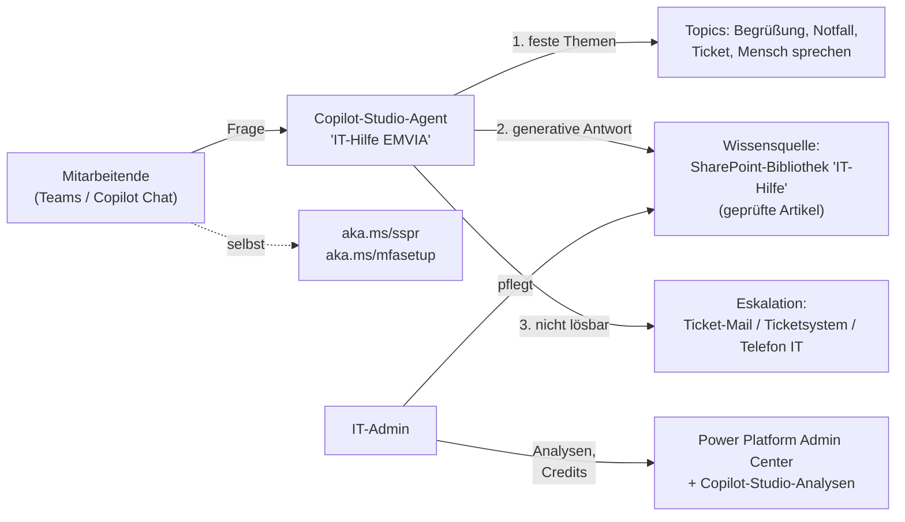

# Project: IT-Helpdesk-Agent für Pflegekräfte (Copilot Studio)

> Ziel: Erstes sichtbares Projekt bei EMVIA. Ein KI-Agent in Teams beantwortet die
> häufigsten IT-Fragen der Mitarbeitenden rund um die Uhr: MFA, Kennwort, neues Handy,
> Outlook/Teams, Tablet. Er leitet alles andere sauber an die IT weiter.
> Verwandt: [[project_emvia-job]] · IT-Werkbank-Modul „EMVIA · M365 & MDM“

Dateien in diesem Ordner:
- `Agent-Anweisungen.md`: Anweisungstext für Copilot Studio (Instructions, zum Einfügen)
- `Themen.md`: feste Gesprächsabläufe (Topics) mit Auslösesätzen und Eskalation
- `Wissen/*.md`: Hilfeartikel in einfacher Sprache = Wissensquelle des Agenten
- `Testfragen.md`: Testset für Abnahme und Regressionstest

---

## 1. Warum dieses Projekt zuerst?

| Kriterium | Bewertung |
|---|---|
| Nutzen | Pflege arbeitet im Schichtdienst. Fragen wie „Kennwort vergessen“ kommen nachts und am Wochenende, wenn die IT nicht da ist. |
| Entlastung IT | Wiederkehrende Standardfragen fallen weg, die IT gewinnt Zeit für echte Probleme. |
| Risiko | Gering: Der Agent liest nur geprüfte Hilfeartikel und ändert NICHTS an Konten. |
| Sichtbarkeit | Hoch: Jede Mitarbeiterin sieht ihn in Teams. |
| Aufwand v1 | ca. 3–5 Arbeitstage, verteilt auf 2–3 Wochen (inkl. Abstimmung und Pilot) |

Bewusst NICHT in v1: Kennwort zurücksetzen durch den Agenten, Konten entsperren, Zugriff auf
Bewohner- oder Personaldaten. Das sind Aktionen mit Identitätsprüfung und Haftung, dafür gibt
es Self-Service (SSPR) bzw. die IT.

---

## 2. Architektur

- **Kanal:** Microsoft Teams (und Microsoft 365 Copilot Chat). Kein öffentlicher Webchat, nur
  für angemeldete Mitarbeitende.
- **Wissen:** eine eigene SharePoint-Bibliothek „IT-Hilfe“, in die NUR die IT schreibt.
  Der Agent antwortet ausschließlich daraus, nicht aus dem Internet und nicht aus dem
  gesamten Tenant (sonst landen interne Dokumente in Antworten).
- **Umgebung:** eigene Power-Platform-Umgebung (z. B. „IT-Agenten“) statt der Standard-
  Umgebung → klare Rechte, DLP-Richtlinie, Kostenkontrolle.

---

## 3. Vorab klären (Woche 1 bei EMVIA)

- [ ] **Freigabe** durch IT-Leitung. Datenschutzbeauftragte/r informieren, ggf. Betriebsrat
      (KI-System für Mitarbeitende, Protokollierung von Gesprächen).
- [ ] **Lizenzen und Kosten:** Haben die Pflegekräfte M365-Copilot-Lizenzen? Vermutlich nicht.
      Dann wird jede Agent-Nutzung über **Copilot Credits** abgerechnet (Pay-as-you-go oder
      Credit-Packs). → Abrechnung in Azure einrichten (Pay-as-you-go mit **Budget-Alarm**)
      und im Pilot den echten Verbrauch je Gespräch messen. Erst danach hochrechnen
      (Gespräche/Monat × Credits/Gespräch). Preise und Regeln vorher auf der aktuellen
      Microsoft-Lizenzseite prüfen, sie haben sich 2025/26 mehrfach geändert.
- [ ] Dürfen Agenten in Teams überhaupt veröffentlicht werden? (Teams Admin Center >
      App-Richtlinien, Copilot-Studio-Einstellungen im Power Platform Admin Center)
- [ ] Ticketweg: Ticketsystem mit Mail-Eingang? Telefonnummer/Zeiten der IT? Notfallnummer
      außerhalb der Dienstzeit?
- [ ] Welche Inhalte sind EMVIA-spezifisch (MFA-Methode, SSPR aktiv?, MDM-App, Tablet-Typ)?
      → in den Hilfeartikeln die `{Platzhalter}` ersetzen.
- [ ] Sprachen: Viele Pflegekräfte sprechen Deutsch nicht als Erstsprache → einfache
      Sprache. Der Agent darf in der Sprache antworten, in der gefragt wird.

---

## 4. Bauanleitung Copilot Studio (Schritt für Schritt)

1. **SharePoint vorbereiten:** Team-Website „IT-Hilfe“ (nur IT = Besitzer/Mitglieder, alle
   Mitarbeitenden = KEIN Schreibrecht). Bibliothek „Artikel“. Die Dateien aus `Wissen/`
   (Platzhalter ersetzt) als Word oder PDF hochladen. Ein Artikel = ein Thema, klarer Titel.
2. **Copilot Studio** (https://copilotstudio.microsoft.com) > richtige Umgebung wählen >
   Neuer Agent > Name „IT-Hilfe EMVIA“, Sprache Deutsch.
3. **Anweisungen:** Text aus `Agent-Anweisungen.md` einfügen.
4. **Wissen hinzufügen:** SharePoint > Bibliothek „Artikel“. **Websuche/allgemeines Wissen
   AUS** (Einstellungen > Generative KI: nur angegebene Quellen nutzen). Warten, bis alle
   Quellen den Status „Bereit“ haben.
5. **Themen** aus `Themen.md` anlegen (v. a. Notfall, Ticket, Mit Mensch sprechen). Das
   System-Thema „Eskalieren“ auf das Ticket-Thema umleiten.
6. **Authentifizierung:** „Mit Microsoft authentifizieren“ (Teams/M365), damit nur
   Mitarbeitende Zugriff haben.
7. **Testen** im Testbereich mit `Testfragen.md`. Jede Antwort muss eine Quelle zeigen.
   Fragen außerhalb des Themas müssen höflich abgelehnt und an die IT verwiesen werden.
8. **Veröffentlichen** > Kanal Teams und Microsoft 365. Zuerst **nur für eine
   Pilotgruppe** (eine Sicherheitsgruppe) freigeben.
9. **Nach dem Veröffentlichen erneut prüfen:** Stehen die Wissensquellen auch im
   veröffentlichten Agenten auf „Bereit“? (Es gibt Berichte, dass SharePoint-Quellen nach
   dem Teams-Publish auf „Fehler“ springen.) Jede Änderung danach erneut veröffentlichen.

---

## 5. Pilot und Rollout

| Phase | Dauer | Inhalt | Erfolgskriterium |
|---|---|---|---|
| Pilot | 2–3 Wochen | 1 Einrichtung / 10–20 Personen inkl. Pflegedienstleitung | ≥ 80 % der Testfragen korrekt, keine falsche Sicherheitsauskunft |
| Auswertung | 1 Woche | Analysen: häufigste Fragen, unbeantwortete Fragen, Credits | neue Artikel für die Top-Lücken, Kosten/Monat hochgerechnet |
| Rollout | stufenweise | Einrichtung für Einrichtung, Info-Mail + Aushang (QR-Code zum Agenten in Teams) | Ticketanzahl der Standardthemen sinkt |

**Kennzahlen (monatlich an IT-Leitung):** Gespräche, Lösungsquote (ohne Eskalation),
Eskalationen, Top-5-Themen, Credits/Kosten, unbeantwortete Fragen → neue Artikel.

---

## 6. Sicherheit und Datenschutz

- Der Agent sieht nur die Bibliothek „IT-Hilfe“, keine Bewohner-, Pflege- oder Personaldaten.
- Er führt keine Aktionen an Konten aus und fragt nie nach Kennwörtern oder MFA-Codes.
  Diese Regel steht in den Anweisungen UND in den Artikeln (Phishing-Schutz).
- Gesprächsprotokolle/Analysen: Aufbewahrung und Einsicht mit Datenschutz und ggf.
  Betriebsrat abstimmen.
- DLP-Richtlinie in der Power-Platform-Umgebung: keine Konnektoren außer SharePoint und
  Office 365 Outlook (für die Ticket-Mail).

---

## 7. Ausbaustufen (nach erfolgreichem v1)

1. **Ticket direkt anlegen** per Power Automate (Formular im Chat → Ticketsystem/Mail mit
   Name, Einrichtung, Gerät, Beschreibung).
2. **Gerätefragen:** „Welches Gerät habe ich / ist es konform?“ über eine Intune-Abfrage
   (nur Lesen, nur eigenes Gerät), erst nach Rücksprache mit Datenschutz.
3. **Mehrsprachigkeit** gezielt testen (z. B. Englisch, Polnisch, Vietnamesisch, Ukrainisch,
   Türkisch, je nach Belegschaft).
4. Später ggf. **Azure AI Foundry** für Pro-Code-Szenarien. v1 bleibt bewusst Low-Code.

---

## 8. Pitch an die IT-Leitung (3 Sätze)

> Ich möchte einen KI-Helpdesk in Teams aufbauen, der die häufigsten Fragen unserer
> Mitarbeitenden (MFA, Kennwort, Handy, Outlook) rund um die Uhr aus geprüften
> IT-Artikeln beantwortet und alles andere als Ticket an uns weitergibt. Der Agent hat
> keinen Zugriff auf Bewohner- oder Personaldaten und ändert nichts an Konten. Ich starte
> mit einem 3-wöchigen Pilot in einer Einrichtung und lege danach Nutzen, Kosten
> (Copilot Credits) und Lösungsquote vor.
