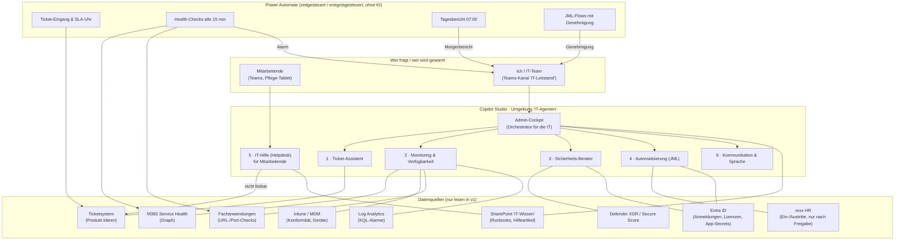

# Project: KI-Assistenten-Familie für die IT-Administration (Copilot Studio)

> **Ziel:** Ein Satz von Copilot-Studio-Agenten, der meine Arbeit als IT-Admin (M365 & MDM)
> bei EMVIA entlastet: Tickets vorsortieren, proaktiv vor Problemen warnen, Dienste und
> Fachanwendungen überwachen, Sicherheit beraten, Routinen automatisieren, Mitarbeitende
> unterstützen und E-Mails/Kommunikation professionell formulieren.
>
> Verwandt: [[Project_EMVIA-Helpdesk-Agent]] (= Agent 5 dieser Familie, bereits ausgearbeitet) ·
> [[Agenten-Anweisungen]] · [[Infosammlung-Woche-1]] · **Start: [[Bauanleitung-Agent1-IT-Leitstand]]** · IT-Werkbank-Modul „EMVIA · M365 & MDM“
> (Wiki `emvia/09-ticket-schnellhilfe`, `10-automatisierung`, `11-monitoring-logs-proaktiv`).

---

## 0. Was ich über EMVIA weiß (Stand 12.10.2026)

| Thema | Wissen | Quelle / Status |
|---|---|---|
| Unternehmen | Betreiber von Pflegeeinrichtungen, Sitz Hamburg, gegründet 2017 (Nachfolge Marseille-Kliniken-Betrieb). Laut aktuellen Stellenanzeigen ca. **4.200 Mitarbeitende in ca. 55 Einrichtungen** fast bundesweit; Marken u. a. Senioren-Wohnpark, Amarita | öffentliche Quellen, Zahlen schwanken je Datum → in Woche 1 bestätigen |
| Konsequenz | **Viele Standorte, Schichtdienst, viele Nutzer ohne festen PC** (Pflege-Tablets/Diensthandys, Frontline-Lizenzen wahrscheinlich) → Fernadministration, MDM und Self-Service sind der Hebel | Annahme |
| M365 | wird genutzt (Umfang, Lizenzen, Hybrid/Cloud-only unbekannt) | bekannt |
| Ticketsystem | wird genutzt, **Produkt unbekannt** | klären |
| MDM | wird genutzt, **Produkt unbekannt** (Intune wahrscheinlich, aber nicht bestätigt) | klären |
| rexx systems | HR-Software (Personalakte, Bewerbermanagement, Self-Service); meine Daten dort eingepflegt | bekannt |
| Fachanwendungen | Pflegedokumentation, Dienstplanung, Abrechnung etc. — **Produkte unbekannt** | klären |

**Warum rexx für mich als IT-Admin wichtig ist:** rexx ist sehr wahrscheinlich die **Quelle der
Wahrheit für Ein-, Um- und Austritte** (Joiner/Mover/Leaver). Wenn Eintrittsdatum, Einrichtung,
Funktion und Austrittsdatum dort stehen, kann das Onboarding/Offboarding später automatisiert
ausgelöst werden — statt per Mail von der Personalabteilung. Ob rexx eine Schnittstelle zu
Entra ID hat (SCIM, REST-Export, CSV-Export), ist offen → bei rexx bzw. HR erfragen.
Microsoft bietet dafür **API-gesteuerte Bereitstellung (Entra Inbound Provisioning, ab Entra P1)**,
die auch CSV-Exporte aus HR-Systemen verarbeiten kann.

> ⚠️ **Grenze:** Personaldaten aus rexx gehören NIE in meine private Werkbank, in Cloud-LLMs
> außerhalb des EMVIA-Tenants oder in dieses Repo. Alles, was Personal- oder Bewohnerdaten
> berührt, läuft ausschließlich im EMVIA-Tenant und nur nach Freigabe (Datenschutz, Betriebsrat).

---

## 1. Grundprinzipien (gelten für alle Agenten)

1. **Erst verstehen, dann bauen.** Woche 1–4: lesen, Berichte ziehen, dokumentieren. Kein Agent
   im EMVIA-Tenant ohne Freigabe der IT-Leitung.
2. **Lesen vor Handeln.** v1 jedes Agenten liest, fasst zusammen, schlägt vor. Schreibende Aktionen
   (Konto sperren, Lizenz entziehen, Gerät löschen) nur mit **Mensch-Freigabe** (Genehmigung in
   Teams/Outlook über Power Automate „Approvals“).
3. **Zwei Zielgruppen trennen:** *Mitarbeitende* (Helpdesk, einfache Sprache, nur geprüfte Artikel)
   vs. *IT-Team* (Admin-Cockpit, technische Daten, eigene Sicherheitsgruppe).
4. **Kosten sichtbar machen.** Autonome/zeitgesteuerte Agenten verbrauchen **Copilot Credits bei
   jeder Ausführung**, auch ohne Nutzer. → Budget-Alarm, Abfrage-Intervalle sparsam, wo möglich
   **Power Automate ohne KI** (Flows kosten keine Credits) und KI nur für Zusammenfassen/Formulieren.
5. **Eigene Power-Platform-Umgebung „IT-Agenten“** mit DLP-Richtlinie, keine Standardumgebung.
6. **Least Privilege:** jeder Flow mit eigenem Dienstkonto/App-Registrierung, nur die nötigen
   Graph-Berechtigungen (z. B. `ServiceHealth.Read.All`, `DeviceManagementManagedDevices.Read.All`),
   Zertifikat statt Secret, Ablaufdatum im Monitoring.

---

## 2. Architektur

**Lesart:** Die *Flows* (unten) sammeln regelmäßig Daten und schlagen Alarm — billig, zuverlässig,
ohne KI. Die *Agenten* (Mitte) kommen ins Spiel, wenn etwas **verstanden, zusammengefasst,
bewertet oder formuliert** werden muss. Das Admin-Cockpit ist mein einziger Ansprechpartner und
delegiert an Fach-Agenten (Copilot-Studio-Multi-Agent: übergeordneter Agent ruft untergeordnete auf).

---

## 3. Die Agenten im Einzelnen

### 1 · Ticket-Assistent
| | |
|---|---|
| **Aufgabe** | Neue Tickets lesen → Kategorie (Konto/MFA, Gerät/MDM, Outlook/Teams, Fachanwendung, Netzwerk, Drucker, Berechtigung), Dringlichkeit (P1–P4), betroffene Einrichtung erkennen; Lösungsvorschlag aus Runbooks; Antwortentwurf an den Melder |
| **Proaktive Vorwarnung** | SLA-Uhr: Ticket > X h ohne Bearbeitung → Hinweis im Kanal. **Häufung:** ≥ 3 Tickets zum gleichen Thema / gleichen Standort in 30 min → „Mögliche Störung, nicht Einzelfall“ |
| **Datenquelle** | Ticketsystem (Konnektor je nach Produkt: ServiceNow, Jira Service Management, Freshservice, TOPdesk, Zendesk haben Power-Automate-Konnektoren; bei reinem Mail-Ticketing: Outlook-Konnektor auf das IT-Postfach) |
| **v1** | Nur Vorschlag/Entwurf, ich entscheide. Keine automatische Antwort an Mitarbeitende |
| **Nutzen** | Schnellere Erstreaktion, Störungen früher erkennen, einheitliche Kategorien → Auswertbarkeit |

### 2 · Monitoring & Verfügbarkeit (Fachanwendungen und Dienste)
| | |
|---|---|
| **Aufgabe** | „Ist alles grün?“ beantworten; Morgenbericht 07:00 im Teams-Kanal |
| **Prüft** | M365 Service Health (Exchange, Teams, SharePoint, Intune, Entra) · Erreichbarkeit der Fachanwendungen (HTTP-Status/Antwortzeit der Web-Oberflächen, ggf. Ports über Azure Monitor/Agent im EMVIA-Netz) · Intune: Geräte nicht konform / > 14 Tage nicht synchronisiert · **ablaufende App-Secrets/Zertifikate** (Entra-App-Registrierungen, Apple-MDM-Push-Zertifikat, VPP-/DEP-Token!) · Lizenzen fast aufgebraucht · Log-Analytics-Alarme (gesperrte Konten, CA-Blockaden) |
| **Vorwarnung** | Rot sofort (Teams + optional Mail/Push), Gelb im Morgenbericht, mit Vorschlag „was tun“ |
| **Wichtig** | Das **Apple-MDM-Push-Zertifikat** läuft jährlich ab — vergessen = alle iPads/iPhones nicht mehr verwaltbar. Gehört als erstes in die Ablaufüberwachung |
| **v1** | Flows sammeln, Agent fasst zusammen. Health-Check-Intervall 15 min ohne KI, KI nur beim Bericht |

### 3 · Sicherheits-Berater
| | |
|---|---|
| **Aufgabe** | Defender-Vorfälle verständlich zusammenfassen und priorisieren; Secure-Score-Empfehlungen in „Quick Wins diese Woche“ übersetzen; verdächtige Mails/Links bewerten (Header-Analyse); Fragen „Ist das sicher?“ beantworten |
| **Wöchentlich** | Riskante Anmeldungen, Konten ohne MFA, Admin-Rollen ohne PIM, externe Weiterleitungen, Gastkonten ohne Aktivität, veraltete Betriebssysteme |
| **Wenn vorhanden** | **Microsoft Security Copilot** ist in E5 seit 2025/26 teilweise enthalten — prüfen, ob EMVIA Zugang hat; dann diesen Agenten NICHT nachbauen, sondern Security Copilot nutzen |
| **Grenze** | Gibt Empfehlungen, ändert keine Richtlinien. Keine Bewohner-/Personaldaten |

### 4 · Automatisierung (Joiner / Mover / Leaver und Routinen)
| | |
|---|---|
| **Aufgabe** | Eintritt: Konto anlegen, Gruppen nach Einrichtung/Funktion, Lizenz (gruppenbasiert), Postfach/Teams, Gerät zuweisen, Willkommens-Mail mit TAP (Temporary Access Pass) an Vorgesetzte · Wechsel: Gruppen tauschen · Austritt: Anmeldung sperren, Sitzungen widerrufen, Postfach → freigegeben + Weiterleitung an Leitung, Gerät zurücksetzen, Lizenz nach Frist entziehen |
| **Auslöser** | v1: Formular/Ticket von HR · v2: **rexx-Export** (CSV/API) → Entra Inbound Provisioning bzw. Flow |
| **Sicherheitsnetz** | Jeder Lauf erzeugt erst eine **Vorschau** („das würde ich tun“) → Genehmigung in Teams → dann Ausführung → Protokoll ins Ticket |
| **Weitere Routinen** | Monatlicher Lizenzbericht (Einsparpotenzial), inaktive Konten > 90 Tage, leere Gruppen, verwaiste Teams, Intune-Konfigurationssicherung (Skripte im Werkbank-Paket `emvia-endpoint-v1`) |
| **Technik** | Power Automate + Azure Automation Runbooks (PowerShell, Graph, Managed Identity). KI nur für die verständliche Vorschau |

### 5 · IT-Hilfe für Mitarbeitende (Helpdesk)
Bereits vollständig geplant: [[Project_EMVIA-Helpdesk-Agent]] (Anweisungen, Themen, 18 Testfragen,
8 Hilfeartikel). Ergänzung: Bei Störungen, die Agent 2 erkennt, zeigt der Helpdesk automatisch
einen **Störungshinweis** („Teams ist aktuell gestört, die IT arbeitet daran“) → weniger Anrufe.

### 6 · Kommunikation & Sprache
| | |
|---|---|
| **Aufgabe** | E-Mails und Teams-Nachrichten professionell formulieren: Ticketantworten, Störungsmeldungen an alle Einrichtungen, Wartungsankündigungen, Anleitungen in **einfacher Sprache**, Rückfragen an Dienstleister, Eskalationen an die Leitung |
| **Funktionen** | Ton anpassen (freundlich / sachlich / formell), Kürzen, Rechtschreibung, Übersetzen (Belegschaft mehrsprachig), Vorlagen für wiederkehrende Mitteilungen, Zusammenfassung langer Mail-Verläufe |
| **Hinweis** | Für meine eigene Mail-Arbeit reicht oft **Copilot in Outlook** (wenn ich eine M365-Copilot-Lizenz bekomme). Der Agent lohnt sich für *standardisierte* Mitteilungen mit EMVIA-Vorlagen und Tonregeln |
| **Grenze** | Sendet NIE selbst. Liefert Entwürfe, ich schicke ab |

### Admin-Cockpit (Orchestrator)
Ein Agent in Teams nur für das IT-Team. Ich frage in natürlicher Sprache:
„Was ist heute los?“ → Monitoring + offene P1/P2-Tickets · „Fasse Ticket 4711 zusammen und schreibe
eine Antwort“ → Ticket-Assistent + Kommunikation · „Bereite den Austritt von XY vor“ → Automatisierung
(Vorschau + Genehmigung) · „Wie richte ich LAPS ein?“ → Runbooks/Wissen.

---

## 4. Fahrplan

| Phase | Zeitraum | Inhalt | Ergebnis |
|---|---|---|---|
| **0 · Ankommen** | 15.10.–31.10. | Zugänge, Bestandsaufnahme nach [[Infosammlung-Woche-1]], Steckbrief in Werkbank füllen, Systeme kennenlernen, Kolleg:innen und Dienstleister kennenlernen | Steckbrief, Systemlandkarte, Liste der Schmerzpunkte |
| **1 · Quick Wins ohne KI** | Nov. 2026 | Morgenbericht + Ablaufüberwachung (Zertifikate/Secrets) als reine Power-Automate-Flows; Ticketkategorien vereinheitlichen; Runbooks in SharePoint „IT-Wissen“ | sichtbarer Nutzen, Datengrundlage |
| **2 · Pitch & Freigabe** | Ende Nov. | 1-Seiter an IT-Leitung: Nutzen, Kosten (Credits), Datenschutz; Datenschutzbeauftragte/r + ggf. Betriebsrat | Freigabe für Pilot |
| **3 · Pilot Agenten** | Dez.–Jan. | Admin-Cockpit mit Agent 1, 2, 6 (nur für IT-Team) · Helpdesk-Pilot in 1 Einrichtung | Messwerte: Zeitersparnis, Credits/Monat |
| **4 · Ausbau** | ab Feb. 2027 | Agent 3 (bzw. Security Copilot), Agent 4 mit Genehmigungen, rexx-Anbindung, Helpdesk-Rollout | Automatisierte JML-Prozesse |

**Reihenfolge-Logik:** Erst die Daten/Flows (Phase 1), dann die KI darauf. Ein Agent ohne
saubere Datenquelle produziert nur gut formulierte Vermutungen.

---

## 5. Kosten (vor Pitch gegen offizielle Microsoft-Seite prüfen!)

- Copilot Studio rechnet über **Copilot Credits** ab: Pay-as-you-go ca. 0,01 USD/Credit oder
  Kapazitätspaket ca. 200 USD/Monat für 25.000 Credits (tenantweit geteilt) — Stand laut
  Drittquellen, nicht offiziell verifiziert.
- **Teuer:** autonome Auslöser (jede Ausführung ohne Nutzer zählt), generative Antworten mit
  Tenant-Grounding, Reasoning-Modelle. **Billig/kostenlos:** Power-Automate-Flows ohne KI,
  klassische Themen mit festen Antworten.
- Sparregel: Flows prüfen und filtern → **nur Auffälliges** geht an den Agenten.
- Im Pilot echten Verbrauch je Agent messen (Power Platform Admin Center > Verbrauch), Budget-Alarm
  in Azure setzen, erst dann hochrechnen.

---

## 6. Datenschutz und Mitbestimmung

- KI-Systeme, die Mitarbeiter-Interaktionen protokollieren oder Ticketdaten auswerten, sind im
  Pflegeumfeld **mitbestimmungsrelevant** (Leistungs-/Verhaltenskontrolle möglich) → Betriebsrat
  früh einbinden, Zweck schriftlich begrenzen („IT-Betrieb, keine Leistungsbewertung“).
- Datenschutz: Verzeichnis der Verarbeitungstätigkeiten ergänzen, Aufbewahrung der Gesprächsprotokolle
  festlegen, EU-Datengrenze/Datenresidenz der Copilot-Studio-Umgebung prüfen.
- **EU AI Act:** Diese Agenten sind kein Hochrisiko-System (keine Entscheidungen über Personen),
  aber Transparenzpflicht — Mitarbeitende müssen wissen, dass sie mit einer KI sprechen.
- Keine Gesundheits-/Bewohnerdaten (Art. 9 DSGVO) in Agenten-Quellen oder Tickets für KI.

---

## 7. Erfolgskennzahlen

| Kennzahl | Messung | Ziel nach 3 Monaten Pilot |
|---|---|---|
| Erstreaktionszeit Tickets | Ticketsystem | −30 % |
| Störungen vor dem ersten Anruf erkannt | Morgenbericht/Alarm-Log | > 50 % |
| Abgelaufene Zertifikate/Secrets | Ablaufüberwachung | 0 |
| Helpdesk-Lösungsquote ohne Ticket | Copilot-Studio-Analysen | ≥ 40 % der Standardfragen |
| JML-Aufwand je Fall | Zeitmessung vorher/nachher | von ~45 min auf < 10 min |
| Kosten | Credits/Monat | innerhalb Budget |

---

## 8. Pitch an die IT-Leitung (3 Sätze)

> Ich möchte unseren IT-Betrieb schrittweise proaktiv machen: Zuerst automatische Morgenberichte
> und Ablaufwarnungen (ohne KI, ohne Zusatzkosten), danach ein KI-Assistent in Teams, der Tickets
> vorsortiert, Störungen früh erkennt und Antworten vorformuliert. Alle Aktionen an Konten und
> Geräten bleiben bei uns und laufen nur nach Freigabe, Personal- und Bewohnerdaten sieht die KI nicht.
> Ich starte mit einem Pilot nur für das IT-Team und lege nach 4–6 Wochen Zeitersparnis und
> tatsächliche Kosten vor.

---

## Quellen (Recherche 12.10.2026)
- EMVIA-Unternehmensdaten: Ärzte Zeitung, jobvoting.de, Stellenanzeigen (Zahlen je Datum abweichend)
- Entra API-gesteuerte Bereitstellung: https://learn.microsoft.com/en-us/entra/identity/app-provisioning/what-is-hr-driven-provisioning
- Copilot-Studio-Kosten (Drittquellen, vor Nutzung offiziell prüfen): samexpert.com/copilot-studio-licensing-guide, cloudzero.com/blog/copilot-studio-pricing
- Autonome Auslöser/Multi-Agent: dev.classmethod.jp/en/articles/copilot-studio-templates-triggers-multiagent
