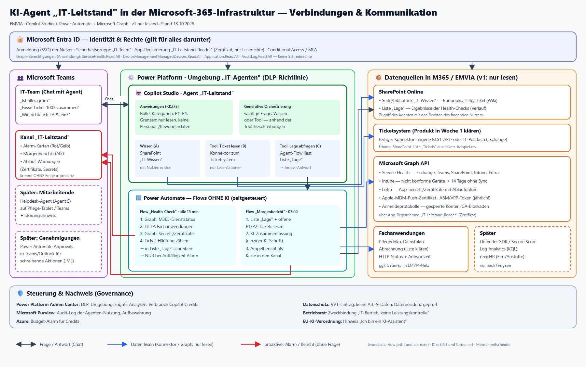

# EMVIA · KI-Assistenten — Übersicht aller Projektdateien

> Einstieg: **[[Bauanleitung-Agent1-IT-Leitstand]]** · Gesamtplan: [[Project_EMVIA-KI-Assistenten]]

## In diesem Ordner (`00_Wissen/03_Aktuelles/Active/EMVIA-KI-Assistenten/`)

| Datei | Inhalt |
|---|---|
| `Project_EMVIA-KI-Assistenten.md` | Gesamtplan: 6 Agenten, Architektur, Fahrplan, Kosten, Datenschutz, Pitch |
| `Bauanleitung-Agent1-IT-Leitstand.md` | **Start hier:** erster Agent Schritt für Schritt, Checkliste R1–R11, Messwerte |
| `Agenten-Anweisungen.md` | Anweisungstexte zum Einfügen in Copilot Studio (je Agent) |
| `Infosammlung-Woche-1.md` | Was ich in Woche 1 bei EMVIA klären muss |
| `Uebung/tickets-beispiel.csv` | 10 erfundene Tickets für die Übung im Test-Tenant |
| `Diagramme/Bauplan-Agent1-IT-Leitstand.png` (+ `.svg`) | Bilddiagramm: Zeitplan, Bauschritte 1–7, Regeln, Checkliste |
| `Diagramme/Architektur-M365-Integration.png` (+ `.svg`) | Bilddiagramm: Verbindung des Agenten mit Entra, Teams, SharePoint, Graph, Ticketsystem |

## Nachbar-Ordner `../EMVIA-Helpdesk-Agent/` (Agent 5 für Mitarbeitende)

| Datei | Inhalt |
|---|---|
| `Project_EMVIA-Helpdesk-Agent.md` | Plan Helpdesk-Agent |
| `Agent-Anweisungen.md` · `Themen.md` · `Testfragen.md` | Anweisungen, Themen, 18 Testfragen |
| `Wissen/01–08*.md` (+ `Wissen/docx/`) | 8 Hilfeartikel (Kennwort, Authenticator, Handy, Phishing, Outlook, Teams, Tablet, IT-Kontakt) |

## IT-Werkbank (Admin-Wissen, privat) `10_Business/01_Marktprodukte/IT-Werkbank/app-live/`

- `wissen/emvia/00–12*.md` — M365-Architektur, Admin-Spickzettel, Konten, Exchange, Lizenzen/MFA, Intune,
  Teams/SharePoint, Copilot-Helpdesk, Neu in M365 2026, Ticket-Schnellhilfe, Automatisierung,
  Monitoring proaktiv, Intune-Skripte
- `app/paket_emvia_m365.py` · `paket_emvia_endpoint.py` · `paket_emvia_betrieb.py` — Skript-Pakete

> Keine EMVIA-Personal-, Bewohner- oder Kundendaten in dieses Repo.
