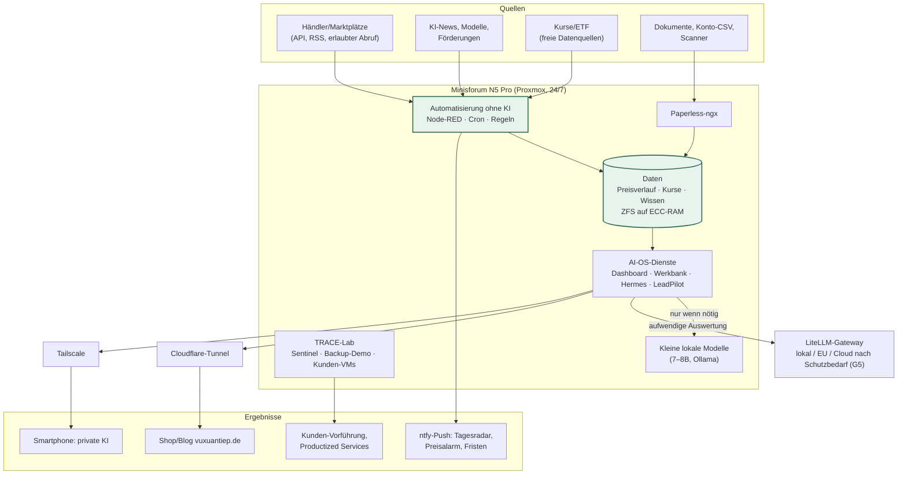

# N5 Pro Nutzungskonzept: Mehr Wert aus dem Heimserver

> Entwurf v0.1 · 25.11.2026 · Status: **KONZEPT, Hardware noch nicht gekauft**
> Bezug: [[TRACE_Leitkonzept_Nachhaltige_Infrastruktur]], [[productized-service-pflicht-digitalisierung]]
> Konzeptarbeit ist vom Wirtschaftlichkeits-Gate ausgenommen. **Wird eine Idee zum verkauften Produkt, braucht sie vorher ihr eigenes Gate** (CLAUDE.md Regel 4).

#idee #trace-ai #infrastruktur #automatisierung #wichtig

---

## 1. Ausgangslage

**Gerät:** Minisforum N5 Pro (AMD Ryzen AI 9 HX PRO 370, 5 HDD-Schächte, 3 × M.2/U.2, PCIe x16, max. 96 GB DDR5 ECC, 10 GbE + 5 GbE, OCuLink).
Angebot: Barebone mit 128-GB-System-SSD für **859 €** (Rabatt von 959 €).

**RAM-Recherche (Stand 25.11.2026, live auf eBay.de):**
- ECC-SO-DIMMs sind knapp und teuer. Kingston Server Premier 32 GB neu kostet 1.216–1.563 €.
- Echte 24-GB-ECC-Riegel gab es nicht. Die 64-GB-ECC-Auktion wurde nicht gewonnen.
- Bestes Angebot: **Samsung 32 GB ECC SO-DIMM M426R4GA3BB0-CQK**, DDR5-4800, gebraucht, 500 € VB + 15 € Versand, 2 Stück verfügbar.
- **Falle:** Ist nur „On-Die-ECC“ angegeben, ist es **kein** echtes ECC. Das gilt z. B. für Crucial CT…C46S5 und Patriot. Bei Samsung steht M426 für ECC-SO-DIMM, M425 für normalen Laptop-RAM.
- **Plan:** Mit 1 × 32 GB ECC starten (Single-Channel reicht für NAS und VMs). Später denselben Riegel nachkaufen, dann laufen 64 GB im Dual-Channel.

**Realistische Gesamtkosten:** ca. 1.300–1.400 € ohne Festplatten. Deshalb muss das Gerät **Geld sparen oder Geld bringen** und darf nicht nur als Homelab dienen.

**Grenzen:**
- Keine starke GPU. Mit 32 GB laufen nur kleine lokale Modelle (7–8B).
- Aufwendige KI-Auswertungen laufen über den **LiteLLM-Gateway** (Cloud/EU, Grundsatz G5).
- Das N5 Pro **sammelt, speichert, plant und rechnet**. Die KI kommt nur dort zum Einsatz, wo sie nötig ist.

## 2. Leitsatz

> **Verkaufe Ergebnisse und Verantwortung, nicht Texte oder Code.**

Das N5 Pro ist **Werkzeug und Vorführgerät**, kein eigenes Geschäftsmodell. Es setzt den Productized-Service-Gedanken um: Der Kunde kauft das Ergebnis, und die Plattform bleibt unser internes Werkzeug (Leitkonzept, Abschnitt 7).

## 3. Die neun Ideen

| # | Idee | Nutzen | Art | Aufwand | KI-Last |
|---|---|---|---|---|---|
| 1 | **AI-OS-Server statt VPS:** Dashboard, IT-Werkbank, Hermes, LeadPilot, Cloudflare-Tunnel laufen 24/7 auf dem N5 | 💰 VPS-Miete fällt weg, keine Abstürze mehr am Laptop | Kosten sparen | mittel | gering |
| 2 | **RAM-Preis-Radar** für den Shop: täglicher Preisverlauf, Schnäppchen-Alarm, wöchentlicher Blog-Entwurf | 💰 Ersetzt die Handrecherche, eigene Preisdaten, später Preisalarm für Käufer | Shop | mittel | gering |
| 3 | **Paperless-ngx:** Dokumentenarchiv mit Texterkennung für Jobcenter, Steuer, MFH Neßdeich, Rechnungen | ⏱️ Belege in Sekunden finden | Zeit sparen | gering | keine |
| 4 | **Immobilien-Tools:** Betriebskosten aus Konto-CSV, Rendite-/Finanzierungsrechner, Mietspiegel-Vergleich | 💰 Eigenbedarf MFH, gleichzeitig Eigentest für Standbein E | Dogfooding | mittel | gering |
| 5 | **Anlage-Übersicht (Aktien/ETF):** Depot-Dashboard mit freien Datenquellen, Kostenvergleich, News-Zusammenfassung, Rebalancing-Rechner | 📊 Überblick und Lernen | privat | mittel | gering |
| 6 | **TRACE-IT-Vorführgerät:** Sentinel-Pilot, Backup-Dienst zum Vorführen, Proxmox- und M365-Lab | 💰 Kunden gewinnen, das ist das Kerngeschäft | Vertrieb | mittel | keine |
| 7 | **KI-Chancen-Radar weltweit:** neue Tools, Modelle, Förderrunden, Geschäftsmodelle, Preisänderungen, täglich per ntfy | 📈 Chancen früh sehen, Futter fürs Gate | Strategie | gering (Bestehendes zusammenführen) | gering |
| 8 | **Reine Automatisierung (Node-RED):** Preisalarme, Backups, Belege ablegen, Lead-Radar, Kunden-Überwachung, Fristen | ⏱️ Größter Alltagsnutzen bei kaum Last | Zeit sparen | gering je Ablauf | keine |
| 9 | **Private KI fürs Smartphone:** N5 als KI-Server per Tailscale, Second Brain von unterwegs fragen, kleine Modelle offline auf dem Handy | 🔒 KI ohne Cloud, Vorführung für „souveräne KI“ | Standbein B | gering | mittel |

**Hinweise:**
- **#5:** nur Analyse und Übersicht. Keine Anlageempfehlung durch die KI, kein automatischer Handel. Vermögen und Kapitalerträge sind beim Bürgergeld anrechnungsrelevant, deshalb vor größeren Anlagen mit dem Jobcenter klären.
- **#7:** baut auf Vorhandenem auf: Research-Agent :5320, LLM-Markt-Check 7 Uhr, Tech-News-Tab der IT-Werkbank, SearXNG. Sammeln und Bewerten passiert **ohne KI** per Regeln. Nur die Zusammenfassung schreibt ein kleines Modell. „Mit KI Vermögen schaffen“ wird nüchtern bewertet: Echtes Geld entsteht durch gesenkte Kosten oder ein gelöstes Problem eines zahlenden Kunden, nicht durch Kursversprechen.
- **#2 und #7:** Beim Abruf fremder Seiten die Nutzungsbedingungen beachten. Wo vorhanden, offizielle Schnittstellen und RSS bevorzugen.

## 4. Architektur

**Lesart:** Zuerst kommen Regeln und Automatisierung (grün), die KI erst danach und nur wenn nötig. Damit bleiben RAM und Strom geschont, und jedes Modell ist austauschbar.

## 5. Reihenfolge

| Phase | Was | Beleg für „fertig“ |
|---|---|---|
| **0** | Hardware: N5 Pro + 32 GB ECC, Proxmox, Backup-Konzept (3-2-1) | Proxmox läuft, erstes Backup zurückgespielt |
| **1** | #1 AI-OS umziehen, VPS kündigen | Dashboard 7 Tage stabil über Tunnel, VPS-Kosten entfallen |
| **2** | #3 Paperless + #8 erste Node-RED-Abläufe | Belege 2026 erfasst, 3 Abläufe laufen |
| **3** | #2 RAM-Preis-Radar + #7 KI-Chancen-Radar | 30 Tage Preisverlauf, tägliche Push-Nachricht |
| **4** | #4 Immobilien-Tools (Eigentest MFH), #9 Smartphone-KI | Betriebskostenabrechnung 2026 aus dem System |
| **5** | #6 TRACE-Vorführgerät, #5 Anlage-Übersicht | Erste Kundenvorführung |

## 6. Wenn alle eine KI in der Hand haben: Was bleibt wertvoll?

**Was billig wird:** Texte, einfacher Code, Übersetzungen, Standard-Recherche, allgemeines Wissen.

**Was knapp und wertvoll bleibt:**
1. **Verantwortung und Haftung.** Eine KI unterschreibt nichts. Kunden wollen jemanden, der dafür einsteht.
2. **Anbindung an echte Systeme** wie Turbomed, NAVIS, DATEV, TI, Firewall und Backup.
3. **Eigene Daten und Zusammenhänge**, z. B. Preisverläufe, Kunden- und Branchenwissen. Deshalb ab heute sammeln.
4. **Vertrauen und Datenschutz.** Die Frage „Wo liegen meine Daten?“ wird wichtiger.
5. **Die physische Welt:** Hardware, Einsatz vor Ort, Schulung.
6. **Urteilsvermögen und Auswahl.** Beispiel RAM-Kauf: Angebote finden war leicht, die Fallen erkennen war die eigentliche Arbeit.
7. **Beziehungen und Reichweite**, also Empfehlungen und Stammkunden.

→ Übernommen ins [[TRACE_Leitkonzept_Nachhaltige_Infrastruktur]] (Abschnitt 1a).

## 7. Offene Entscheidungen

- [ ] N5 Pro für 859 € kaufen? Vorher prüfen: Ist die MwSt. enthalten, und berührt der Kauf den Förderplan (Einstiegsgeld/LES)?
- [ ] RAM: Samsung M426 32 GB ECC per Preisvorschlag (Ziel 420–450 €)?
- [ ] Reihenfolge der Phasen bestätigen
- [ ] Wird aus #2 (Preisalarm für Käufer) oder #9 ein Produkt? Wenn ja, Gate starten.
