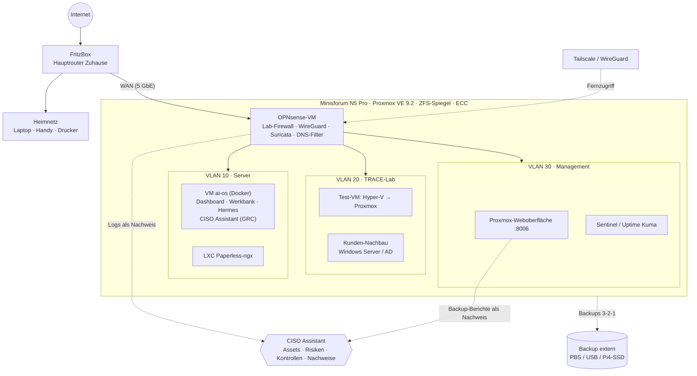

# Homelab-Serverumgebung: Open Source, Proxmox VE und OPNsense

> Stand 27.11.2026 · Lern- und Planungsnotiz · Status: **KONZEPT** (N5 Pro noch nicht gekauft)
> Bezug: [[2026-11-25_N5-Pro-Nutzungskonzept]], [[Runbook_Umzug_AI-OS_N5-Pro]], [[TRACE_Leitkonzept_Nachhaltige_Infrastruktur]], [[TRACE_Sentinel_Architektur]], GRC: `07_Sicherheit/GRC-CISO-Assistant/README.md`

#homelab #infrastruktur #sicherheit #wichtig

**Versionsstand (geprüft 27.11.2026):**

| Produkt | Aktuelle Version | Quelle/Datum |
|---|---|---|
| Proxmox VE | **9.2** (Debian 13.5, Kernel 7.0, ZFS 2.4, QEMU 11.0) | Pressemitteilung Proxmox, 21.05.2026 |
| Proxmox VE 8.4 | nur noch Sicherheitsupdates **bis August 2026** → jetzt veraltet | Proxmox-Forum FAQ |
| OPNsense Community | **26.7.x** (zuletzt 26.7.9 gesehen) | opnsense.org/blog |
| OPNsense Business Edition | **26.10** (28.10.2026), Patch 1 am 13.11.2026 | docs.opnsense.org |
| CISO Assistant | Community, läuft im AI-OS seit 27.11.2026 | eigene Installation |

---

## 1. 💡 Das Prinzip Open Source

**Kurz:** Der **Quellcode ist offen**. Jeder darf ihn lesen, nutzen, verändern und weitergeben. Welche Pflichten dabei gelten, regelt die **Lizenz**.

| Lizenz-Typ | Beispiele | Was sie bedeutet |
|---|---|---|
| **Copyleft stark** | GPL, **AGPL** (CISO Assistant), AGPL bei Proxmox | Wer verändert weitergibt, muss den Code offenlegen. Bei der AGPL gilt das schon, wenn andere die Software **über das Netz nutzen** |
| **Freizügig** | BSD (**OPNsense**), MIT, Apache 2.0 | Man darf fast alles, auch in eigene geschlossene Produkte einbauen |

**Geschäftsmodell dahinter:** Die Software ist kostenlos. Geld verdienen die Hersteller mit
**Support, Enterprise-Updates, Schulungen und Hardware**. Beispiele:
- **Proxmox Server Solutions:** Subscription für das stabilere Enterprise-Repository und Support
- **Deciso** (Niederlande, hinter OPNsense): Business Edition und eigene Firewall-Appliances
- **intuitem** (hinter CISO Assistant): Pro- und Enterprise-Version

**Merksatz für TRACE:** Open Source heißt **frei von Lizenzkosten**, aber **nicht frei von Arbeit**. Genau diese Arbeit (Einrichten, Betreiben, Verantworten) ist das, was wir verkaufen. Das passt zum Leitsatz „Ergebnisse und Verantwortung verkaufen“.

## 2. 💡 Vor- und Nachteile

| ✅ Vorteile | ❌ Nachteile / Risiken |
|---|---|
| Keine Lizenzkosten, kein Abo-Zwang | Support nur über Community oder bezahlte Subscription |
| **Kein Vendor-Lock-in**, Daten und Formate bleiben offen (Leitkonzept: anbieterunabhängig) | Mehr Eigenverantwortung: Updates, Backups, Härtung macht man selbst |
| Code prüfbar → Vertrauen, keine versteckten Hintertüren (theoretisch prüfbar, praktisch tun es wenige) | Ohne Betreuung schnell veraltet und dann ein Sicherheitsrisiko |
| Große Gemeinschaft, viele Anleitungen und Foren | Doku manchmal nur auf Englisch oder lückenhaft |
| Läuft lokal → **DSGVO-freundlich**, Daten verlassen das Haus nicht | Für Kunden muss jemand **haften** (das sind dann wir) |
| Wissen ist übertragbar: Proxmox/OPNsense-Wissen gilt bei jedem Kunden | Manche Funktionen gibt es nur in der kostenpflichtigen Edition (z. B. OPNsense-BE-DNS-Server) |
| Lizenz-Risiko gering, aber prüfen: AGPL bei Weiterverkauf als Dienst beachten | |

**Fazit:** Für Homelab, Lernen und kleine Kunden (Praxen, Kanzleien, KMU) ist Open Source ideal.
**Bedingung:** Ein fester Betriebsplan (Updates, Backup, Überwachung) gehört immer dazu.

## 3. 💡 Virtualisierung mit Proxmox VE

**Was:** Proxmox VE ist ein **Hypervisor** auf Debian-Basis. Er macht aus einem Rechner viele
virtuelle Rechner. Bedient wird er über eine Weboberfläche (Port **8006**).

**Zwei Arten von „Gästen“:**

| | **VM** (KVM/QEMU) | **Container** (LXC) |
|---|---|---|
| Was | kompletter virtueller PC mit eigenem Kernel | teilt sich den Kernel mit dem Host |
| Für | Windows, OPNsense, alles mit eigenem Betriebssystem | schlanke Linux-Dienste (z. B. Paperless, Pi-hole) |
| RAM/Start | mehr Verbrauch, langsamer Start | sehr sparsam, Start in Sekunden |
| Isolation | stark | schwächer |

**Wichtige Bausteine:**
- **ZFS:** Dateisystem mit Prüfsummen, Snapshots und Spiegelung. Mit **ECC-RAM** am sichersten. Deshalb der ECC-Plan beim N5 Pro.
  ⚠️ Die ZFS-ARC-Grenze setzen (`zfs_arc_max`), sonst belegt ZFS den RAM (siehe Runbook).
- **Snapshots:** vor jedem Update einen Snapshot anlegen. Geht etwas schief, ist man in Sekunden wieder auf dem alten Stand.
- **Proxmox Backup Server (PBS):** eigenes Backup-Produkt mit Deduplizierung. Für die **3-2-1-Regel** am besten auf einer zweiten Hardware oder extern.
- **Repositories:** ohne Subscription das `pve-no-subscription`-Repository eintragen (für Homelab üblich, Updates kommen etwas früher und weniger erprobt). Das Enterprise-Repository braucht eine Subscription.
- **Cluster/HA:** erst ab 3 Knoten sinnvoll. Für das Homelab nicht nötig.

**Im AI-OS-Plan:** Proxmox ersetzt auf dem N5 Pro das mitgelieferte MinisCloud-System. VM `ai-os` mit Docker (Dashboard, Werkbank, Hermes, **CISO Assistant**), LXC für Paperless,
und eine Test-VM für den Pilot **Hyper-V → Proxmox** (TRACE Sentinel).

## 4. 💡 Die Open Source Firewall OPNsense

**Was:** Firewall- und Router-Betriebssystem auf **FreeBSD-Basis** (BSD-Lizenz), 2015 als Abspaltung von pfSense entstanden. Bedienung über die Weboberfläche. Updates kommen zweimal im Jahr (Versionen **.1 im Januar** und **.7 im Juli**), dazwischen Patches.

**Was sie kann (Auswahl):**
| Funktion | Nutzen im Homelab / bei Kunden |
|---|---|
| Stateful Firewall, Regeln pro Netz | Netze sauber trennen |
| **VLANs** | Netztrennung: Server, Clients, IoT, Gäste, Lab |
| **WireGuard / OpenVPN / IPsec** | sicherer Fernzugriff, Standortkopplung |
| **Unbound DNS** + Blocklisten | Werbung/Tracker blocken (wie Pi-hole) |
| **Suricata** (IDS/IPS) | Angriffe erkennen und blockieren |
| CrowdSec, ACME (Let's Encrypt), HAProxy/Caddy als Plugins | Schutz und Reverse Proxy |
| Zentrale Logs, Syslog-Export, NetFlow | **Nachweise für Audits** → passt zu CISO Assistant |
| 2FA, Konfig-Backup, Rollen | Härtung, Wiederherstellung |

**Wo läuft sie?** Zwei Wege:
1. **Als VM auf Proxmox:** günstig und gut zum Lernen. Nachteil: Ist der Host aus, ist auch das Netz aus.
2. **Eigene kleine Hardware** (Mini-PC mit 2–4 Netzwerkkarten): empfohlen für das **echte Hauptnetz** und für Kunden. Die Firewall soll nicht von einem Server abhängen.

**Empfehlung fürs Homelab:** zuerst Weg 1, und zwar **hinter der FritzBox als Lab-Firewall**, nicht als Haupt-Router. Dann fällt das Internet zu Hause nicht aus, wenn im Lab etwas schiefgeht. Der N5 Pro hat mit **10 GbE + 5 GbE** zwei Anschlüsse: einen für WAN (Richtung FritzBox), einen für LAN/VLANs zum Lab.

## 5. 💡 Empfehlungen & Praxisbeispiele

### 5.1 Zielbild Homelab

**Lesart:** Die FritzBox bleibt für das Heimnetz zuständig. OPNsense schützt nur das Lab und trennt es per VLAN in Server, TRACE-Lab und Management. CISO Assistant dokumentiert das Ganze wie bei einem echten Audit.

### 5.2 Empfehlungen (Reihenfolge)

| # | Empfehlung | Warum |
|---|---|---|
| 1 | Proxmox VE **9.2** frisch installieren, kein 8.x mehr | 8.4 bekommt seit August 2026 keine Updates mehr |
| 2 | ZFS-Spiegel + `zfs_arc_max` setzen, **erstes Backup zurückspielen** | Ein Backup zählt erst, wenn die Wiederherstellung getestet ist |
| 3 | Proxmox-Weboberfläche **nie** ins Internet, nur per Tailscale/WireGuard | Port 8006 offen im Netz ist ein typisches Einfallstor |
| 4 | OPNsense-VM hinter der FritzBox, erst 1 VLAN, dann ausbauen | Klein anfangen, Heimnetz nicht gefährden |
| 5 | 2FA für Proxmox und OPNsense, eigene Admin-Konten statt `root` | Grundhärtung, Audit-Pflichtpunkt |
| 6 | Updates **monatlich** an einem festen Termin, vorher Snapshot | Open Source lebt von Pflege |
| 7 | Alles in **CISO Assistant** erfassen: Geräte als Assets, Lücken als Risiken, Maßnahmen als Kontrollen | So wird aus dem Homelab ein Nachweis für die GRC-Bewerbung |

### 5.3 Praxisbeispiele (zum Nachbauen)

**A. Netztrennung mit VLANs (Lernziel: Segmentierung, ISO 27001 A.8.22)**
Drei VLANs in OPNsense anlegen (10 Server, 20 Lab, 30 Management). Regel: Lab darf **nicht** ins Server-Netz. Testen: Ping von der Lab-VM auf `ai-os` muss scheitern. Nachweis: Screenshot der Regel plus Testergebnis in CISO Assistant ablegen.

**B. Fernzugriff per WireGuard (Lernziel: sicherer Remote-Zugang)**
WireGuard-Plugin in OPNsense, ein Peer fürs Handy. Danach ist die Proxmox-Oberfläche von unterwegs erreichbar, **ohne** offenen Port 8006.

**C. Kundennahes Szenario: Praxis/Kanzlei nachbauen (Lernziel: TRACE-IT-Angebot)**
Windows-Server-VM (AD) und Client-VM im VLAN 20, OPNsense als Praxis-Firewall mit DNS-Filter und Suricata. Danach Snapshot-Backup und Wiederherstellung üben. Das ist eine fertige Vorführung für Praxen (Turbomed-Umfeld) und Kanzleien.

**D. Migration Hyper-V → Proxmox (Lernziel: TRACE-Sentinel-Pilot)**
Eine unkritische Hyper-V-VM exportieren (VHDX), in Proxmox importieren (`qm importdisk`), Treiber (VirtIO) nachziehen, Abnahme dokumentieren. Hintergrund: Viele kleine Firmen suchen nach den Lizenzänderungen bei VMware/Broadcom Alternativen.

**E. Audit-Kreislauf (Lernziel: GRC-Plattform praktisch)**
In CISO Assistant: Assessment „Homelab nach ISO 27001:2022“ anlegen → Anforderungen durchgehen → für Netztrennung, Backup und Fernzugriff die Belege aus A–D anhängen → Restrisiken bewerten. Das ist genau der Ablauf, den eine GRC-Firma verkauft.

## 5a. IAM, IGA und Audit (Ergänzung 27.11.2026)

Gesamtarchitektur als Bilddiagramm mit allen Diensten und der neuen Sicherheitsebene:
`04_Infrastruktur/Dokumentation/Architektur/AI-OS_Homelab_Gesamtarchitektur.html`
(online: https://claude.ai/artifact/ML936M3Zm7NTTxnK9WdbfN).

| Bereich | Vorschlag | Wo |
|---|---|---|
| IAM/SSO | Keycloak 26.1.1 → **26.8** (Workflows ab 26.6, SCIM ab 26.8), MFA, OIDC für Dashboard/CISO/Werkbank | Laptop, Phase 1 |
| Verzeichnis | **LLDAP**, später **Samba AD** für Kunden-nahes Üben | Laptop, Phase 1 |
| Geheimnisse | **Vaultwarden**, später OpenBao | Laptop, Phase 1 |
| IGA (Join/Move/Leave) | **midPoint** + HR-Quelle `personal.csv` | N5 Pro, Phase 2 |
| SIEM/Audit | **Wazuh 4.14.x** (Logs von Keycloak, OPNsense, Proxmox, Windows) | N5 Pro, Phase 2 |
| Härtung/Scans | **Lynis, Trivy**, später **Greenbone** | Phase 1–3 |
| Nachweise | CISO Assistant: ISO-27001-Assessment „Homelab“ | Phase 3 |

## 6. Offene Entscheidungen
- [ ] OPNsense als VM (Lernen) oder später eigene Hardware (Hauptnetz)?
- [ ] Backup-Ziel für PBS: Pi4-SSD, USB-Platte oder extern?
- [ ] Bleibt die FritzBox Hauptrouter? (Empfehlung: ja, zumindest am Anfang)

---

**Quellen (abgerufen 27.11.2026):**
- [Proxmox VE 9.2 Pressemitteilung (21.05.2026)](https://www.proxmox.com/en/about/press-releases/proxmox-virtual-environment-9-2)
- [Proxmox-Forum: Proxmox VE 9.2 available (inkl. FAQ zu 8.4)](https://forum.proxmox.com/threads/proxmox-virtual-environment-9-2-available.183741/latest)
- [OPNsense Business Edition 26.10 Release Notes](https://docs.opnsense.org/releases/BE_26.10.html)
- [OPNsense Blog (Community 26.7.x)](https://opnsense.org/blog/)
- [AlternativeTo: OPNsense BE 26.10 (11/2026)](https://alternativeto.net/news/2026/11/opnsense-releases-business-edition-26-10-with-enhanced-firewall-and-dns-capabilities/)
