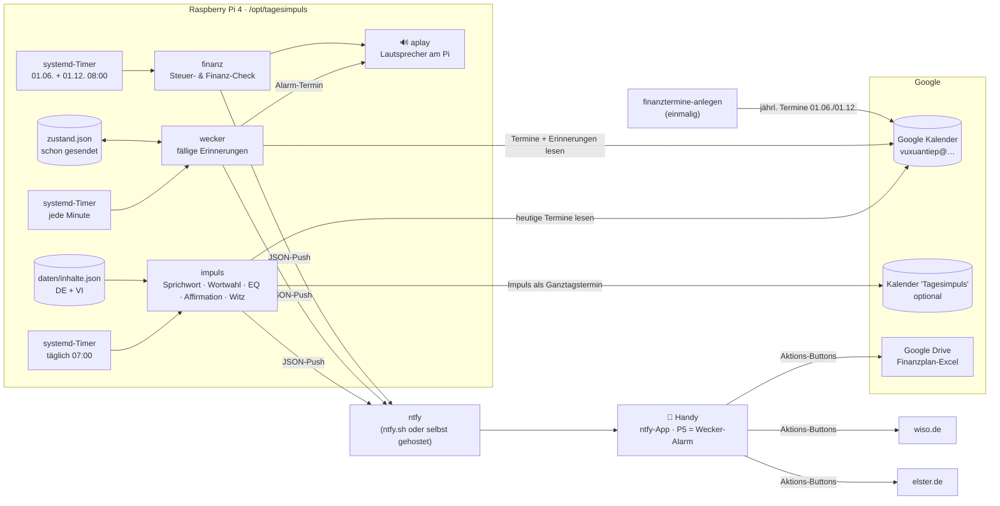

# Architektur: Tagesimpuls & Kalender-Wecker (Raspberry Pi 4)

Stand 12.10.2026 · bei Änderungen mitpflegen.

## Gesamtbild

## Entscheidungen

| Frage | Entscheidung | Warum |
|---|---|---|
| Zugang Google | Service-Account, Kalender für dessen E-Mail freigegeben | Pi läuft ohne Bildschirm/Browser, kein OAuth-Token läuft ab |
| Ton/Wecker aufs Handy | ntfy mit Priorität 4/5 | Google Calendar kann nur stille Pop-ups/E-Mails; ntfy kann pro Topic eigenen Ton und bei Priorität 5 Dauer-Alarm |
| Alarm-Kennzeichnung | ⏰/„Wecker“/„Alarm“ im Titel oder Farbe Tomate | direkt in Google Calendar steuerbar, ohne zweite App |
| Inhalte | kuratiertes JSON statt LLM | Vietnamesisch muss korrekt sein; Pi4 hat kein gutes lokales Modell; keine Kosten |
| Rotation | jährlich gemischte Reihenfolge, Tag des Jahres = Index | zustandslos, keine Wiederholung pro Runde |
| Scheduler | systemd-Timer mit `Persistent=true` | holt verpasste Läufe nach Stromausfall nach |
| Finanz-Link | nur in `.env` / exportierter .ics (gitignored) | privater Drive-Link gehört nicht ins öffentliche Repo |

## Ausbauideen
- Eigene Einträge per Telegram/ntfy-Antwort „merken“ → `inhalte.json` erweitern
- Abend-Reflexion 21:00 („Welches Wort hat heute gut gewirkt?“)
- Optional kurzer LLM-Kommentar über LiteLLM/Cloud-Kette, nur zum Erklären – Inhalte bleiben kuratiert
- ntfy selbst auf dem Pi hosten (Docker) und nur über Tailscale erreichbar machen
