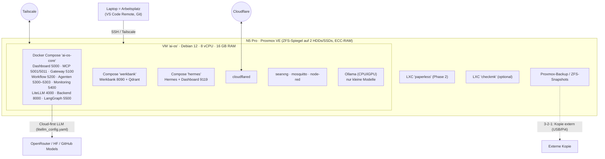

# Runbook: Umzug AI-OS auf Minisforum N5 Pro (Phase 1)

> Entwurf v0.1 · 25.11.2026 · Status: **VORBEREITUNG, Hardware noch nicht geliefert**
> Bezug: [[2026-11-25_N5-Pro-Nutzungskonzept]] (Phase 1), [[TRACE_Leitkonzept_Nachhaltige_Infrastruktur]]
> Am laufenden System auf dem Laptop wurde **nichts verändert**. Alle Werte unten sind eine Bestandsaufnahme vom 25.11.2026.

#infrastruktur #runbook #ai-os #n5-pro

---

## 1. Ziel und „fertig, wenn …“

**Ziel:** Alle 24/7-Dienste des AI-OS laufen auf dem N5 Pro statt auf dem Laptop. Der Laptop wird wieder reiner Arbeitsplatz. Das N5 Pro ersetzt den geplanten CPU-only-VPS ([[project_vps-migration]]) und spart dessen Miete.

**Fertig, wenn:**
- [ ] `ai-os.vuxuantiep.de` und `it-avatar.vuxuantiep.de` laufen **7 Tage stabil** vom N5 Pro aus.
- [ ] Alle Dienste starten nach einem Neustart des N5 Pro **ohne Handarbeit**.
- [ ] Mindestens ein Backup wurde **erfolgreich zurückgespielt**.
- [ ] Die Aufgaben in der Windows-Aufgabenplanung auf dem Laptop sind deaktiviert. Es läuft nichts doppelt.

## 2. Bestandsaufnahme (Laptop, 25.11.2026)

### 2.1 Native Python-Dienste (`04_Infrastruktur/Runtime/start_ai_os.py` + Aufgabenplanung)

| Dienst | Skript | Port | Autostart heute |
|---|---|---|---|
| Dashboard | `04_Infrastruktur/Gateway/ai_os_dashboard.py` | 5000 | Aufgabe „AI-OS Dashboard“ (deaktiviert) / start_ai_os |
| MCP Server | `04_Infrastruktur/Gateway/mcp_server.py` | 5001 | „AI-OS MCP Server“ (deaktiviert) |
| MCP Protocol Server | `04_Infrastruktur/Gateway/mcp_protocol_server.py` | 5011 | „AI-OS MCP Protocol Server“ (läuft) |
| API Gateway | `04_Infrastruktur/Gateway/api_gateway.py` | 5100 | start_ai_os |
| Workflow Engine | `05_Agenten/workflow_engine.py` | 5200 | start_ai_os |
| Agent System | `05_Agenten/agent_system.py` | 5300 | „AI-OS Agent System“ (läuft) |
| Spezial-Agenten Cal/Bubble/Higgsfield | `05_Agenten/agents/*.py` | 5301–5303 | start_ai_os (auch in `docker-compose.yml`) |
| Monitoring | `08_Monitoring/monitoring_service.py` | 5400 | start_ai_os |
| LiteLLM Gateway | `04_Infrastruktur/Gateway/litellm_gateway.py` | 4000 | „AI-OS LiteLLM Gateway“ (deaktiviert) |
| Backend (FastAPI) | `backend/` via `Runtime/backend_autostart.py` | 8000 | „AI-OS Backend“ (deaktiviert) |
| LangGraph Engine | `05_Agenten/langgraph_engine.py` | 5500 | manuell |
| KI-Avatar / Research / LeadPilot | eigene Module | 5310 / 5320 / 5330 | manuell / Dashboard |
| Täglicher Backup-Job | `09_Backup-Recovery/backup_manager.py` | – | „AI-OS Daily Backup“ (03:00) |
| Tunnel-Watchdog | – | – | „AI-OS Tunnel Watchdog“ (stündlich) |

### 2.2 Docker-Container

| Container | Herkunft | Ports | Status |
|---|---|---|---|
| `cloudflared` | Tunnel, Config `~/.cloudflared/config.docker.yml` | – | läuft |
| `app-live-werkbank-1` + `app-live-qdrant-1` | `10_Business/01_Marktprodukte/IT-Werkbank/app-live` (Compose) | 8090 | läuft |
| `hermes`, `hermes-dashboard` | `C:\Users\vuxua\hermes-agent` (Compose), Daten `~/.hermes` → `/opt/data` | 9119 (nur lokal) | läuft |
| `monitoring` (Checkmk) | eigenständig | 8080, 8001 | läuft |
| `searxng` | eigenständig | 8888 | läuft |
| `mosquitto` | eigenständig | 1883 | läuft |
| `node-red`, `keycloak`, `openhands-app`, `broki-empfang-*` | – | – | **seit Monaten gestoppt**. Nur mitnehmen, wenn wirklich gebraucht |

### 2.3 Öffentliche Routen (Cloudflare-Tunnel)

| Hostname | Ziel heute | Ziel auf dem N5 |
|---|---|---|
| `ai-os.vuxuantiep.de` | `host.docker.internal:5000` | Dashboard-Container/-VM :5000 |
| `it-avatar.vuxuantiep.de` | `host.docker.internal:8090` | Werkbank-Container :8090 |

### 2.4 Daten und Größen

| Was | Ort heute | Größe |
|---|---|---|
| Git-Repo (Code + Vault) | `AI-OS/` | ca. 1,6 GB `00_Wissen` + 1,3 GB `.git` |
| Gedächtnis / Vektor-Store | `06_Gedächtnis/` | ca. 7 MB |
| Ollama-Modelle | `~/.ollama/models` | **28 GB**, nicht alle nötig, siehe 4.3 |
| Hermes-Daten | `~/.hermes` | ca. 430 MB |
| Secrets | zentrale Root-`.env`, `01_Verbindungen/APIs/Geheimnisse/`, `~/.cloudflared/*.json` + `cert.pem` | klein, **nie über Git** |

### 2.5 Windows-Abhängigkeiten im Code (Prüfung 25.11.)

- **Keine fest eingetragenen `C:\Users`-Pfade** in den Kerndiensten gefunden. ✅
- Windows-Sonderfälle (`CREATE_NO_WINDOW`, `powershell`) stehen in `ai_os_dashboard.py`, `litellm_gateway.py`, `llm_router.py`, `mcp_server.py`, `mcp_protocol_server.py`, `backend_autostart.py`, `ollama_autostart.py`, `openhands_launcher.py`.
- Die meisten sind schon mit `os.name == "nt"` abgesichert. **`llm_router.py:248`** und die Dashboard-Funktionen, die Windows-Aufgaben und Dienste steuern, müssen unter Linux getestet werden.
- Die Autostart-Skripte mit wscript/vbs ([[project_terminal-fenster-flackern]]) **entfallen** auf Linux und werden durch Docker `restart: unless-stopped` ersetzt.

## 3. Zielarchitektur auf dem N5 Pro

**Entscheidungen (Vorschlag, CEO-Freigabe offen):**
1. **Eine Debian-VM mit Docker** für alle AI-OS-Dienste statt vieler LXC. Das ist einfacher, entspricht dem heutigen Aufbau und lässt sich als Ganzes sichern.
2. **Native Python-Dienste werden zu Containern.** Ein gemeinsames Image `ai-os-core` (Python + `requirements.txt`), ein Dienst je Port. Die vorhandene `docker-compose.yml` (Agenten, Ollama, Qdrant) wird dafür erweitert.
3. **Cloud-first LLM bleibt** (wie seit 30.07. in `litellm_config.yaml`). Lokal laufen nur kleine Modelle, weil 32 GB RAM von VMs und ZFS mitbenutzt werden.
4. **RAM-Budget 32 GB:** Proxmox + ZFS-ARC ca. 6 GB · VM ai-os 16 GB (inkl. Ollama 7–8B) · Paperless 3 GB · Reserve 7 GB. Die ZFS-ARC-Grenze setzen (`zfs_arc_max`), sonst belegt ZFS den RAM.
5. **Git bleibt die Wahrheit für den Code.** Auf dem N5 wird `git pull` ausgeführt. Daten (Wissen, Hermes, Modelle) liegen in Volumes und werden gesichert.

## 4. Vorbereitung auf dem Laptop (geht schon ohne Hardware)

| # | Aufgabe | Ergebnis |
|---|---|---|
| V1 | `Dockerfile.core` + `docker-compose.core.yml` für alle nativen Dienste schreiben | Ein Befehl `docker compose up -d` startet das gesamte AI-OS |
| V2 | **Testlauf unter Linux auf dem Laptop** (Docker Desktop/WSL) mit **anderen Ports**, damit der laufende Betrieb nicht gestört wird | Windows-Sonderfälle gefunden und abgesichert |
| V3 | Pfade und Hosts nur über `.env` (z. B. `OLLAMA_URL`, `AI_OS_ROOT`, `PI_LLM_URL`) | Gleicher Code auf Laptop und N5 |
| V4 | Liste der wirklich genutzten Ollama-Modelle (aus `litellm_config.yaml`/Router) | Statt 28 GB nur das Nötige kopieren |
| V5 | Secrets-Übertragung planen: `.env`, `Geheimnisse/`, Tunnel-JSON + `cert.pem` **verschlüsselt per USB oder `scp` über Tailscale** | Kein Secret in Git oder Cloud |
| V6 | Dashboard-Funktionen, die Windows-Aufgaben steuern (Dienste-Stop, Autostart, RAM-Guard), auf Linux-Gegenstück (`docker` statt `schtasks`/`taskkill`) prüfen | Liste der Anpassungen |
| V7 | Checkliste für den Hardware-Tag (Abschnitt 5) ausdrucken oder im Dashboard abhaken | – |

## 5. Ablauf am Hardware-Tag

**A. Hardware & Proxmox (ca. 2 h)**
1. RAM einbauen (Platine herausziehen, Lüfter lösen; siehe NEMIX-Anleitung). Den ersten Start mit **MemTest86** prüfen, damit ECC erkannt wird.
2. BIOS: aktuelles Update, Virtualisierung (SVM/IOMMU) an, ECC-Status ansehen.
3. Proxmox VE vom USB-Stick installieren, auf die 128-GB-System-SSD. Die vorinstallierte MinisCloud wird dabei ersetzt. Vorher entscheiden, ob du sie behalten willst.
4. ZFS-Pool auf den Datenlaufwerken anlegen (mindestens Spiegel), `zfs_arc_max` setzen.
5. Tailscale auf dem Proxmox-Host, Name z. B. `n5-pro`.

**B. VM „ai-os“ (ca. 2 h)**
1. Debian 12 VM (8 vCPU, 16 GB RAM, 100 GB Disk), Docker + Compose installieren.
2. `git clone` des AI-OS-Repos, `.env` und Secrets wie in V5 übertragen.
3. Ollama-Modelle aus V4 übertragen (`scp` über Tailscale).
4. `~/.hermes` übertragen (Hermes vorher auf dem Laptop **stoppen**, damit die Daten konsistent sind).
5. `docker compose up -d` (core, werkbank, hermes, searxng, mosquitto). **cloudflared noch NICHT starten.**
6. Prüfen: Alle Ports antworten innerhalb des Tailnets (`curl http://n5-pro:5000` usw.).

**C. Umschalten (ca. 30 min, abends)**
1. Laptop: `cloudflared`-Container stoppen, Aufgaben „AI-OS Tunnel Watchdog“, „Agent System“ und „MCP Protocol Server“ **deaktivieren**.
2. N5: In `config.docker.yml` `host.docker.internal` durch die Compose-Dienstnamen ersetzen, dann `cloudflared` starten. **Derselbe Tunnel** mit denselben Zugangsdaten, kein DNS-Umbau nötig.
3. Beide Hostnamen extern aufrufen (Handy über Mobilfunk).
4. Tagesimpuls/ntfy, Backup-Job (03:00) und Markt-Check (07:00) als Cron oder Container auf dem N5 einrichten. Auf dem Laptop deaktivieren.

**D. Stabilität (7 Tage)**
- Täglich: Monitoring :5400 und Checkmk ansehen, RAM-Auslastung prüfen (RAM-Guard).
- Tag 3: Backup **zurückspielen** (Test-VM aus dem Snapshot).
- Tag 7: Kriterien aus Abschnitt 1 abhaken. Den Laptop-Betrieb danach nur noch als Notfall-Rückweg behalten.

## 6. Rückweg (falls etwas schiefgeht)

1. N5: `docker stop cloudflared`.
2. Laptop: `docker start cloudflared`, Aufgaben wieder aktivieren. Das AI-OS läuft dann wie vorher.
3. Daten, die auf dem N5 neu entstanden sind (Hermes, Wissen), per `git pull` bzw. Kopie zurückholen.

> Der Rückweg funktioniert nur, solange auf dem Laptop **nichts gelöscht** wird. Aufräumen (Modelle, Container) erst nach 30 stabilen Tagen.

## 7. Risiken

| Risiko | Gegenmaßnahme |
|---|---|
| Zwei Tunnel-Instanzen gleichzeitig: Anfragen landen zufällig auf Laptop oder N5 | Laptop-`cloudflared` **immer zuerst** stoppen (Schritt C1) |
| Port-Kill reißt Docker-Engine mit ([[project_docker-incident-openhands]]) | Auf Linux Dienste nur über `docker compose stop` steuern, nie Ports „hart“ freiräumen |
| RAM knapp (32 GB) | ZFS-ARC begrenzen, Ollama `keep_alive=3m` ([[project_ollama-keep-alive]]), nur kleine Modelle |
| Windows-Code bricht unter Linux | Testlauf V2 **vor** dem Hardware-Tag |
| Stromausfall / Absturz | Alle Container mit `restart: unless-stopped`, Proxmox-VM mit „Start at boot“. Eine USV ist optional |
| Datenverlust | ZFS-Spiegel + tägliche Snapshots + externe Kopie (3-2-1) |

## 8. Offene Entscheidungen (CEO)

- [ ] Proxmox statt MinisCloud-Betriebssystem? (Empfehlung: Proxmox)
- [ ] Eine VM für alles (Empfehlung) oder je Dienst ein LXC?
- [ ] Welche gestoppten Container werden mitgenommen (Node-RED ja, Keycloak/OpenHands/Broki-Empfang nein)?
- [ ] Vorbereitung V1–V3 (Docker-Images + Linux-Testlauf) jetzt schon starten?
