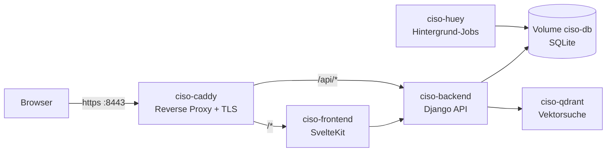

# CISO Assistant – GRC-Plattform im AI-OS

**Was:** Open-Source-Plattform für **Governance, Risk & Compliance** (intuitem, Community Edition, AGPLv3).
**Wozu im AI-OS:** Audit, Sicherheit und Compliance an einem Ort:
- **Risikoregister:** Risiken bewerten, Maßnahmen und Restrisiko festhalten
- **Kontrollen + Nachweise (Evidence):** „Kontrolle umgesetzt, Beleg vom Datum X“
- **Audits / Compliance-Assessments:** gegen ISO 27001, NIS2, DSGVO, BSI IT-Grundschutz u. v. m.
- **Normen-Mapping:** eine Maßnahme deckt mehrere Normen ab

Ausgewählt nach Vergleich mit Eramba Community (27.11.2026): läuft komplett offline, schlanker
(Eramba braucht 4 GB RAM + 10 GB Swap und Verbindung zu eramba.org), viele Normen eingebaut.

## Bedienung

| Was | Wie |
|---|---|
| URL | https://localhost:8443 (nur lokal, an 127.0.0.1 gebunden) |
| Zertifikatswarnung | normal – Caddy erzeugt mit `tls internal` ein eigenes Zertifikat. Einmal bestätigen. |
| Login | `01_Verbindungen/APIs/Geheimnisse/ciso-assistant.txt` (nicht im Git) |
| Start/Stopp | Dashboard → Tab **Dienste** → „CISO Assistant (GRC)“ |
| Start per Konsole | `docker compose up -d` in diesem Ordner |
| Update | `docker compose pull` und danach `docker compose up -d` |

## Aufbau (5 Container, Projekt `ciso-assistant`)



## Abweichungen von der Upstream-Compose (und warum)

| Änderung | Grund |
|---|---|
| Containernamen `ciso-*` statt `backend`/`frontend`/`qdrant`/`caddy` | eindeutig, keine Kollision mit anderen AI-OS-Containern |
| DB in benanntem Volume `ciso-db` statt Ordner `./db` | SQLite auf Windows-Bind-Mounts hat Locking-Probleme, und GRC-Daten landen nie im Git |
| Qdrant ohne Host-Port | Port 6333 ist im AI-OS schon von anderen Qdrant-Instanzen belegt |
| MCP-Profil weggelassen | in der Upstream-Datei als „deprecated“ markiert (PAT mit vollen Rechten) |
| `restart: unless-stopped` statt `always` | „Stopp“ im Dashboard bleibt wirksam |

Härtung aus der Upstream-Datei übernommen: `read_only`, `cap_drop: ALL`, `no-new-privileges`, Nutzer ohne Root-Rechte.

## Backup

Die Daten liegen in Docker-Volumes und werden **nicht** vom ZIP-Backup des AI-OS erfasst.
Manuelle Sicherung:

```powershell
docker run --rm -v ciso-assistant_ciso-db:/data -v ${PWD}:/backup alpine tar czf /backup/ciso-db-backup.tgz -C /data .
```

## Erster Arbeitsschritt (Vorschlag)

1. Framework **ISO/IEC 27001:2022** in der Bibliothek laden.
2. Ein Compliance-Assessment „AI-OS Homelab“ anlegen.
3. Die Lücken aus `07_Sicherheit/Sicherheitskonzept-AI-OS.md` als Risiken ins Risikoregister übernehmen.
