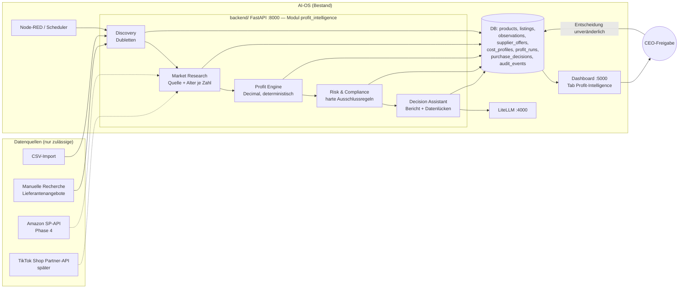
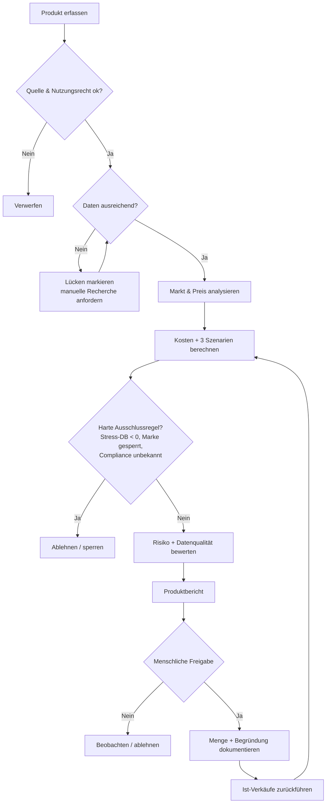

# Architektur — Profit-Intelligence (Stand 13.10.2026, Konzept)

> Pflicht-Diagramm (CEO-Anweisung 17.07.2026). Bei jeder Änderung mitpflegen.

## Komponenten

## Entscheidungsablauf

## Grenzen (Sicherheit)

- Keine Bestellungen, keine Schreibzugriffe aufs Verkäuferkonto im MVP.
- Secrets nur in zentraler `.env` / `01_Verbindungen/APIs/Geheimnisse/`.
- Externe Texte = Daten, nie Anweisungen an den LLM.
- Veraltete/fehlende Daten blockieren die Vorlage zur Freigabe.
