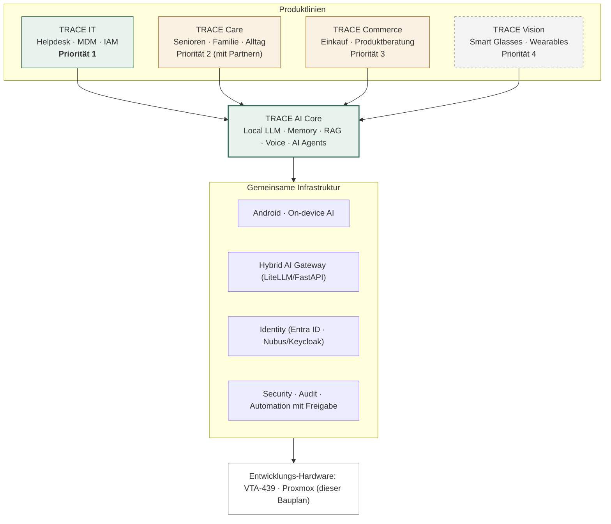
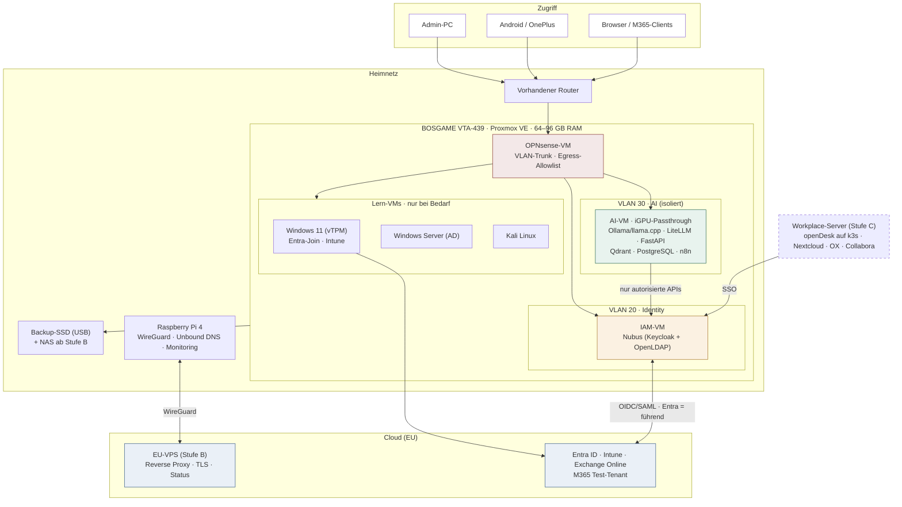

# TRACE AI – Bauplan v2 (korrigiert & zusammengeführt)

#trace-ai #architektur #homelab #wichtig

> **Stand:** 18.11.2026 · **Status:** Planung, **noch nicht gekauft**
> **Quellen:** `TRACE_AI_Einkaufsliste_und_Bauplan_BOSGAME_VTA439.pdf` (17.11.2026) und die drei
> Architekturbilder („Hybride Enterprise- & KI-Infrastruktur", „Enterprise-Lab-Architektur",
> VLAN-Schaubild „Air-Gapped Sovereign AI"), dazu [[Project_TRACE-Enterprise-Lab]] (14.11.2026).
> Dieses Dokument ersetzt die drei Bilder als **eine** gültige Architektur. Preise sind
> Budgetschätzungen aus dem PDF und vor einer Bestellung zu prüfen.

---

## 0. Leitbild: Eine Plattform statt sechs Einzelprojekte (CEO-Vorgabe 18.11.2026, „das Wichtigste")

**TRACE AI – One Platform. Many Lives. · Intelligent. Sicher. Hybrid.**
Alle Geschäftsideen (Mobile IT Helpdesk, MDM Policy Assistant, Senior Companion, Local
Shopping AI, Smart Glasses, Health & Emergency) laufen auf **einer** gemeinsamen Basis.
Die Hardware in diesem Bauplan ist die Entwicklungsumgebung für genau diese Basis.

**Zuordnung Hardware → Plattform:**

| Plattform-Baustein | Wo er im Lab läuft |
|---|---|
| TRACE AI Core (LLM, RAG, Memory, Agenten) | AI-VM (VLAN 30), iGPU-Passthrough |
| Hybrid AI Gateway | LiteLLM + FastAPI in der AI-VM; öffentlich nur über den EU-VPS |
| Identity | IAM-VM (Nubus/Keycloak) + Entra-Test-Tenant |
| MDM / Android / On-device | Windows-11-VM (Intune) + Android-Testgerät (Hardwareliste P3 → **für TRACE IT auf P1 hochstufen**) |
| Audit / Security / Automation mit Freigabe | OPNsense, Logs, n8n mit Freigabe-Schritt |

**Reihenfolge der Produktlinien** (aus dem Marktvergleich vom 18.11.2026, qualitative Einschätzung, keine Marktzahlen):

1. **TRACE IT** (Mobile IT Helpdesk + MDM Policy Assistant): etablierter B2B-Markt (Intune/MDM),
   passt direkt zur eigenen Spezialisierung (Entra ID, Intune, IAM). → Die **Demo in Woche 10–11**
   dieses Bauplans ist genau dieser Einstieg.
2. **TRACE Care**: hoher gesellschaftlicher Nutzen, aber nur mit Partnern (Pflegedienste). Version 1
   ausdrücklich **kein Medizinprodukt** (Alltagsbegleiter, Erinnerungen, Kontakt). Notfall- und
   Sturzerkennung erst mit validierter Sensorik. Sonst MDR-Pflicht (BfArM-Abgrenzung).
3. **TRACE Commerce**: knüpft an Modul 6 (Profit-Intelligence) an. Starker Wettbewerb im Consumer-Bereich.
4. **TRACE Vision**: Zukunftsmarkt. Keine eigene Hardware, sondern Software auf bestehenden Brillen.
   EDSA-Stellungnahme zu Smart Glasses (13.10.2026) beachten: unbemerkte Aufnahmen, Dritte.

> Jede Produktlinie braucht vor der Umsetzung ein **eigenes Wirtschaftlichkeits-Gate** (CLAUDE.md Regel 4).
> Die Hardware-Stufe A dient allen Linien, deshalb ein gemeinsames Gate für den Kauf (Abschnitt 6).

## 1. Was am bisherigen Plan korrigiert wurde

| # | Problem in den Unterlagen | Warum es ein Problem ist | Korrektur |
|---|---|---|---|
| K1 | **Zwei Hypervisoren:** Lab-Plan vom 14.11. = Hyper-V auf Windows 11 (32 GB); Bauplan vom 17.11. = Proxmox auf dem VTA-439 | Zwei Plattformen für dasselbe Lab, doppelte Einarbeitung | **Ein Host, Proxmox.** Die Windows-11-VM für Entra/Intune läuft als VM mit vTPM unter Proxmox weiter. → ⚠️ **Entscheidung CEO** (Abschnitt 6) |
| K2 | **Zwei Server-Modelle:** PDF = BOSGAME VTA-439, VLAN-Bild = Minisforum AI X1 Pro | Uneinheitlich, falsche Teilenummern beim Kauf | Einheitlich **BOSGAME VTA-439** (Ryzen AI 9 HX 470) |
| K3 | **Fünf VMs × 8 GB dauerhaft** (CachyOS, Kali, Windows Server, Ubuntu, Windows 11) **plus** KI-Dienste **plus** openDesk auf einem Rechner | 40 GB nur für Lern-VMs, dazu LLM und openDesk (Kubernetes) → 64 GB reichen nicht | Nur **3 Dauer-VMs** (AI, IAM, Edge). Lern-VMs (Kali, Windows Server, Windows 11) laufen **bei Bedarf** und werden danach gestoppt |
| K4 | **Gaming-VM (CachyOS)** auf dem Lab-Host | Die Radeon 890M lässt sich nur **einer** VM durchreichen: entweder Gaming oder KI | Gaming-VM **gestrichen**. Die iGPU gehört der KI-VM |
| K5 | **RAM:** 48 GB als Einstieg | Die iGPU hat keinen eigenen Speicher (UMA): Modellspeicher geht vom System-RAM ab | **64 GB Minimum, 96 GB empfohlen**, sobald Modelle ab 14B oder openDesk auf demselben Host laufen sollen |
| K6 | **Identity doppelt:** Nubus (enthält schon Keycloak + OpenLDAP) **plus** ein eigenes Keycloak, dazu AD (Windows Server) und Entra ID | Mehrere führende Verzeichnisse → Konflikte, Sync-Chaos. Das PDF warnt selbst davor | **Eine Kette:** Entra ID = Cloud-Identität, **Nubus = einziger lokaler IdP** (das Keycloak darin nutzen). AD nur als Lern-VM. midPoint und Teleport sind Lernmodule der IAM-Spezialisierung, **kein** zweiter IdP |
| K7 | „**Air-Gapped** Sovereign AI" (VLAN 40) | Air-gapped heißt physisch getrennt. Modell-Downloads, Updates und n8n brauchen Netz | Richtig: **„isoliert, ausgehend nur per Allowlist"** (Egress-Filter in OPNsense) |
| K8 | **Firewall:** PDF = eigene Appliance (150–300 €), VLAN-Bild = OPNsense als VM auf dem Lab-Host | Als VM: Fällt der Host aus, ist das Lab-Netz weg, das Heimnetz läuft aber weiter. Als Appliance: mehr Kosten | **Start: OPNsense-VM** nur für die Lab-VLANs, hinter dem vorhandenen Router (spart 150–300 €). Appliance erst in Stufe B. → ⚠️ **Entscheidung CEO** |
| K9 | **Raspberry Pi als QDevice** | Ein QDevice braucht man erst bei einem 2-Node-Cluster; geplant ist **ein** Host. Die Pi-SSD war zudem schon einmal defekt | Pi = **WireGuard, DNS (Unbound), Monitoring**. Kein Cluster-Quorum, keine KI-Last |
| K10 | **Reihenfolge:** Netzwerk (Woche 3) vor Proxmox (Woche 4) | Bei OPNsense als VM braucht man Proxmox zuerst | Proxmox **vor** VLAN/OPNsense (siehe Abschnitt 4) |
| K11 | **Stufe A** mit ca. 1.600–2.300 € angegeben | Die Einzelposten ergeben 1.720–2.440 €. Mit OPNsense als VM (K8) werden es 1.570–2.140 € | Zahlen in Abschnitt 5 korrigiert |
| K12 | **NPU mit 55 TOPS** als KI-Leistung beworben | Ollama/llama.cpp nutzen heute vor allem CPU/iGPU, nicht die NPU (das PDF sagt das selbst) | Planung rechnet **ohne NPU**. NPU nur als Experiment |

## 2. Zielarchitektur (eine statt drei)

**VLAN-Plan (zusammengeführt aus PDF + VLAN-Bild):**

| VLAN | Zone | Inhalt | Regel |
|---|---|---|---|
| 10 | Management | Proxmox-UI, Switch, OPNsense-UI, Pi | nur Admin-PC, nur per WireGuard von außen |
| 20 | Identity | Nubus/Keycloak, später midPoint/Teleport (Lernmodule) | SSO-Ports nur aus VLAN 30/40/50 |
| 30 | AI | AI-VM | eingehend nur über LiteLLM/FastAPI. Ausgehend: Allowlist (Modell-Registry, Updates) |
| 40 | Storage | Backup-Ziel, NAS ab Stufe B | nur von erlaubten Hosts |
| 50 | Clients | PCs, Android, Browser | Zugriff nur auf veröffentlichte Dienste |
| 60 | Guest/IoT | Gäste, Wearables | nur Internet |

> Hinweis: Im PDF hatte die Workplace-Zone VLAN 20 und AI VLAN 30, im VLAN-Bild war es anders.
> Hier gilt jetzt **20 = Identity, 30 = AI**. Der Workplace (openDesk) bekommt in Stufe C ein
> eigenes VLAN 25.

## 3. Ressourcenplan VTA-439 (64 GB)

| Dienst | RAM | Dauerbetrieb |
|---|---|---|
| Proxmox-Host + OPNsense-VM | 4 + 2 GB | ja |
| AI-VM (inkl. iGPU-Anteil für ein 7–14B-Modell, Q4) | 28 GB | ja |
| IAM-VM (Nubus) | 8 GB | ja |
| Reserve / ZFS-Cache | 6 GB | – |
| **Eine** Lern-VM gleichzeitig (Win 11 / Win Server / Kali) | 8–12 GB | nur bei Bedarf |
| **Summe** | **ca. 56–60 GB** | |

→ Mit **96 GB** wäre zusätzlich ein openDesk-Testcluster möglich, bevor ein eigener
Workplace-Server nötig wird (der dann ggf. entfällt oder später kommt).

## 4. Bauplan – korrigierte Reihenfolge

| Woche | Schritt | Fertig, wenn … |
|---|---|---|
| 1 | Kaufprüfung (Checkliste aus dem PDF bleibt gültig) + **Gate-Freigabe** | Angebot inkl. MwSt., EU-Lager, RAM-Kit-Bestätigung schriftlich |
| 2 | Hardware: BIOS-Update, RAM tauschen (beide Module ersetzen, nicht mischen), memtest, SMART | 24 h memtest ohne Fehler |
| 3 | **Proxmox** installieren, IOMMU/iGPU-Passthrough testen | iGPU in einer Test-VM sichtbar |
| 4 | **OPNsense-VM** + Managed Switch, VLAN 10–60, WireGuard über den Pi | Admin-UI nur aus VLAN 10 erreichbar |
| 5 | **AI-Core:** Ollama/llama.cpp, LiteLLM, FastAPI, PostgreSQL, Qdrant. Secrets aus der zentralen `.env` | ein 7B-Modell antwortet über LiteLLM, Token/s gemessen |
| 6 | **Identity:** Nubus, Entra-Test-Tenant per OIDC/SAML verbinden (Entra führend) | Login an einer Test-App mit MFA |
| 7 | **TRACE Enterprise Lab Kern:** Windows-11-VM, Entra-Join, Intune, Conditional Access (bestehende Runbooks) | Runbook Phase 0/1 wiederholbar |
| 8–9 | Sicherheit & Betrieb: Backup + **Restore-Test**, Monitoring, Audit-Logs, Patch-Prozess | Restore einer VM erfolgreich |
| 10–11 | **TRACE-IT-Demo:** Agent liest Test-Wissensbasis, nennt Quellen, legt ein Ticket nur nach menschlicher Freigabe an | Demo-Video + Doku |
| später | Stufe C: openDesk (k3s), Nextcloud, OX, Collabora auf eigenem Host bzw. 96 GB | – |

## 5. Kapitalbedarf (korrigiert)

| Stufe | Inhalt | Budget |
|---|---|---|
| **A – Start** | VTA-439 (1.050–1.150) + 64 GB (180–300) + Backup-SSD (120–250) + USV (120–220) + Managed Switch (100–220). **OPNsense als VM** | **1.570–2.140 €** |
| A+ | wie A, aber 96 GB statt 64 GB | +120–200 € |
| **B – Homelab komplett** | + NAS 4-Bay (400–650) + 2 × 8 TB CMR (400–650) + zusätzliche NVMe (120–220) + Firewall-Appliance (150–300) | **+1.070–1.820 €** |
| **C – Hybrid Enterprise** | + Workplace-Server (1.600–2.800), entfällt evtl. bei 96 GB auf dem VTA-439 | **+0–2.800 €** |
| D – GPU | eGPU über OCuLink oder GPU-Server | +1.500–3.500 € |

## 6. Offene Entscheidungen (CEO)

1. **Hypervisor (K1):** Proxmox auf dem VTA-439 für alles, also das TRACE-Lab von Hyper-V umziehen? *Empfehlung: ja.* Ein Host, und die Windows-11-VM mit vTPM funktioniert auch unter Proxmox.
2. **RAM (K5):** 64 GB oder 96 GB? *Empfehlung: 96 GB, wenn das Budget es erlaubt.* Bei UMA zählt jedes GB, und ein Workplace-Server kann so länger warten.
3. **Firewall (K8):** OPNsense-VM (Start) oder Appliance? *Empfehlung: VM in Stufe A, Appliance in Stufe B.*
4. **Wirtschaftlichkeits-Gate:** Die Investition (Stufe A ca. 1,6–2,1 T€) dient Lernen **und** der TRACE-Produktentwicklung (TRACE IT, TRACE Care, TRACE Commerce). Laut CLAUDE.md Regel 4 vor der Bestellung den Wirtschaftlichkeits-Prüfer laufen lassen und die Freigabe hier eintragen.

**Freigabe-Status:** ⏳ offen

## 7. Sicherheitsgrundsatz (unverändert aus dem PDF)

Das Homelab ist Entwicklungs- und Testumgebung. **Keine echten Senioren-, Gesundheits- oder
Kundendaten** ohne eigenes Datenschutz-, Sicherheits- und Betriebsmodell. Keine Datenbank- oder
Admin-Oberflächen direkt ins Internet, Veröffentlichung nur über den EU-VPS-Gateway.
