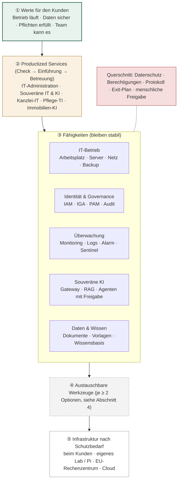

# TRACE Leitkonzept: Nachhaltige, anbieterunabhängige Infrastruktur

> Entwurf v0.2 · 24.11.2026, ergänzt 25.11.2026 (Abschnitt 1a) · Status: **KONZEPT, zur Diskussion mit dem CEO**
> Übergeordnet zu [[TRACE_AI_Gesamtarchitektur]], [[TRACE_AI_Bauplan_v2]], [[productized-service-pflicht-digitalisierung]], [[kundengruppen-positionierung]], [[bewertung-datev-it-admin-und-datev-ki]].
> Konzeptarbeit ist vom Wirtschaftlichkeits-Gate ausgenommen. **Jedes neue Produkt daraus braucht vor der Umsetzung sein eigenes Gate** (CLAUDE.md Regel 4).
> Quellen: abgerufen am 24.11.2026, Typ in Klammern (Regel 6).

#wichtig #trace-ai #leitkonzept #architektur #productized-service

---

## 1. Leitgedanke

> **Werkzeuge kommen und gehen. Was wir bauen, sind Fähigkeiten, Prozesse und Vertrauen, die bleiben.**

- Microsoft, DATEV, KI-Anbieter, Pflegesoftware und Open-Source-Projekte sind **Werkzeuge**. Sie ändern Preise, Lizenzen und Funktionen. Manche verschwinden.
- Die Beispiele von heute zeigen es: DATEV zieht ab Herbst 2026 in die Cloud, der DATEV Copilot ist plötzlich kostenlos, und die Pflegesoftware bringt eigene KI mit.
- **Der Wert für den Kunden** liegt nicht im Werkzeug. Er liegt darin, dass Abläufe laufen, Daten sicher sind, Zugänge stimmen und das Team geschult ist. Und darin, dass er einen Werkzeugwechsel überlebt.
- **Der Wert für TRACE** liegt in wiederverwendbaren Bausteinen: Checklisten, Skripte, Vorlagen, Schulungen, Betriebsabläufe. Sie stecken in jedem Productized Service und werden mit jedem Kunden besser.

## 1a. Verkaufe Ergebnisse und Verantwortung (Ergänzung 25.11.2026)

> **Wenn jeder eine KI in der Hand hat, verkaufen wir nicht Texte oder Code, sondern Ergebnisse und Verantwortung.**

Der Satz entstand bei der Planung des Heimservers ([[2026-11-25_N5-Pro-Nutzungskonzept]]) und **bestätigt den Productized-Service-Ansatz**:

| Wird durch KI billig | Bleibt knapp, darauf baut TRACE |
|---|---|
| Texte, einfacher Code, Übersetzungen | **Verantwortung und Haftung:** jemand steht dafür ein |
| Standard-Recherche, allgemeines Wissen | **Anbindung an echte Systeme:** Turbomed, NAVIS, DATEV, TI, Netz, Backup |
| Einzelne Werkzeuge und Modelle | **Eigene Daten und Zusammenhänge:** Prüflisten, Branchenwissen, Verlaufsdaten |
| | **Vertrauen und Datenhoheit** (Grundsätze G3, G5) |
| | **Die physische Welt:** Hardware, Einsatz vor Ort, Schulung |
| | **Urteilsvermögen:** aus vielen KI-Vorschlägen das Richtige auswählen |
| | **Beziehungen:** Empfehlungen und Abo-Kunden |

**Folge für die Angebote:** Jeder Productized Service verspricht ein **Ergebnis mit Verantwortung**, z. B. „Ihre Praxis-IT läuft sicher, wir stehen dafür ein, Ihre Daten bleiben bei Ihnen.“ KI und Automatisierung sind **unser Werkzeug** und machen das Versprechen bezahlbar. Sie sind nicht das Produkt.

## 2. Sieben Grundsätze der Anbieterunabhängigkeit

| # | Grundsatz | Prüffrage vor jeder Entscheidung |
|---|---|---|
| G1 | **Mindestens zwei Optionen je Fähigkeit:** eine offene oder europäische und eine marktübliche | Gibt es eine gleichwertige Alternative, auf die wir in ≤ 3 Monaten wechseln könnten? |
| G2 | **Offene Standards vor Herstellerschnittstellen:** SAML/OIDC, SCIM, LDAP, Syslog, OpenTelemetry, S3, CalDAV, ODF/PDF | Spricht das Werkzeug einen offenen Standard, oder bindet es uns an sich? |
| G3 | **Daten gehören dem Kunden**, in offenen Formaten exportierbar | Können wir alle Daten heute vollständig und lesbar exportieren? |
| G4 | **Identität ist das Fundament** und wird nie an ein einzelnes Anwendungsprodukt gekoppelt | Würde ein Wechsel der Anwendung die Benutzerverwaltung zerstören? |
| G5 | **KI über eine Vermittlungsschicht** (Gateway): Modell und Anbieter sind austauschbar, lokal / EU / global je nach Schutzbedarf | Läuft dieselbe Aufgabe auch mit einem anderen Modell, ohne Umbau? |
| G6 | **Unabhängige Kontrolle:** Monitoring und Audit laufen getrennt vom überwachten System | Merken wir einen Ausfall auch, wenn das Hauptsystem selbst ausfällt? |
| G7 | **Mensch gibt frei:** kritische Aktionen (Rechte, Löschungen, Zahlungen, KI-Aktionen nach außen) nur mit Freigabe und Protokoll | Wer hat freigegeben, und ist das nachvollziehbar? |

**Exit-Plan als fester Bestandteil:** Jede Kundeneinführung bekommt eine Seite „So wechseln Sie, falls nötig“. Das schafft Vertrauen und unterscheidet uns von Anbietern, die auf Bindung setzen.

## 3. Architektur in fünf Schichten

**Lesart:** Kunden kaufen ①. Wir verkaufen ②. Unser Können steckt in ③. Austauschbar sind ④ und ⑤. Wechselt ein Werkzeug, bleiben ① bis ③ stehen.

## 4. Sicherheit als Fundament: Fähigkeiten und Werkzeug-Optionen

Die Werkzeuge sind **Beispiele** und keine Festlegung. Gewählt wird je Kunde nach Schutzbedarf, Budget und vorhandener Umgebung.

| Fähigkeit | Was sie leistet | Option offen / EU | Option marktüblich | Standard (G2) |
|---|---|---|---|---|
| **IAM** (Identität, Anmeldung, MFA) | Wer ist wer, sicher angemeldet | Keycloak / Nubus | Microsoft Entra ID, Active Directory | OIDC, SAML, LDAP |
| **IGA** (Identity Governance) | Wer darf was, warum, wie lange: Rollen, Ein-/Austritte, Rezertifizierung | midPoint | SailPoint, Saviynt, Entra ID Governance | SCIM |
| **PAM** (privilegierte Zugänge) | Admin-Zugänge kontrolliert und protokolliert | Teleport (Community) | CyberArk, Delinea | SSH-Zertifikate, OIDC |
| **Audit & Logs** | Wer hat wann was getan, beweissicher | Wazuh, Graylog, OpenSearch | Microsoft Sentinel, Splunk | Syslog, OpenTelemetry |
| **Monitoring & Alarm** | Ausfälle früh erkennen, unabhängig (G6) | Zabbix, Prometheus/Grafana, Uptime Kuma, TRACE Sentinel (Pi) | PRTG, Datadog | SNMP, OpenTelemetry |
| **Backup & Wiederherstellung** | Daten zurückholen, getestet | Proxmox Backup Server, restic | Veeam | S3, offene Archive |
| **Souveräne KI** | KI nach Schutzbedarf: lokal, EU oder global | Ollama, LiteLLM-Gateway, Qdrant | Azure OpenAI (EU), Branchen-KI (DATEV Copilot, Pflegesoftware-KI) | OpenAI-kompatible API |
| **Automatisierung mit Freigabe** | Routine abnehmen, Kritisches freigeben lassen | n8n, Node-RED | Power Automate | Webhooks, REST |
| **Arbeitsplatz** | E-Mail, Dateien, Zusammenarbeit | openDesk, Nextcloud | Microsoft 365 | CalDAV, WebDAV, ODF |

**Ableitung für die Angebote:** IAM, IGA, Audit und Monitoring sind **kein eigenes Produkt**. Sie sind das **Qualitätsversprechen in jedem Service**. Bei größeren Kunden lassen sie sich zusätzlich als eigenständiger „Identity & Governance Check“ verkaufen. Das entspricht deiner Spezialisierungsspur S1–S3 im TRACE Lab.

## 5. Standbeine (Geschäft)

„Mehr Standbeine“ heißt hier: **verschiedene Kundengruppen und Einnahmearten auf denselben Fähigkeiten.** Das bedeutet nicht mehr Technik, sondern mehr Wiederverwendung.

| Standbein | Zielgruppe | Productized Service (Einstieg → Kern → Abo) | Reife | Gate |
|---|---|---|---|---|
| **A. IT-Administration** (Kern, heute) | KMU, Justiz-/Gesundheitsumfeld, Projekte | IT-Bestandsaufnahme → Projekt/Einführung → Betreuung & Vertretung | **belegt** (E-Akte 13 Gerichte, NAVIS, Turbomed) | Teil von TRACE IT |
| **B. Souveräne IT & KI** | Unternehmen mit sensiblen Daten | KI-Potenzialanalyse → Local AI / Identity → Betrieb | Lab vorhanden, keine Kundenreferenz | Gate TRACE IT |
| **C. Kanzlei-IT (DATEV)** | DATEV-Steuerkanzleien | Kanzlei-IT-Check → Cloud-Umstieg begleiten → Betreuung + KI-Modul | **im Aufbau** (Zertifizierung läuft) | [[bewertung-datev-it-admin-und-datev-ki]] |
| **D. Pflege-TI** | ambulante Pflegedienste | TI-Alltags-Check → KIM & E-Abrechnung → TI-Betreuung | Erfahrung angrenzend, TI/KIM zu prüfen | offen |
| **E. KI für Immobilien-Investoren** (neu) | private Investoren mit mehreren Objekten | siehe Abschnitt 6 | **Idee**, Eigenbedarf (MFH) vorhanden | **Gate Pflicht vor Umsetzung** |
| **F. Wissen** (später) | IT-Teams, Kanzleien, Pflege | Schulungen: KI-Kompetenz (Art. 4 KI-VO), sichere Zugänge | nach ersten Referenzen | – |
| **G. Eigene Plattformmodule** (später) | Bestandskunden | Lizenz oder Nutzungspauschale für bewährte Bausteine (z. B. Sentinel) | erst ab ≥ 5 Kunden mit gleichem Ablauf | eigenes Gate |

**Regel gegen Verzettelung:** Es werden höchstens **zwei Standbeine gleichzeitig aktiv beworben**. Die anderen laufen über Empfehlungen oder sind in Vorbereitung. Die Reihenfolge ergibt sich aus Belegen (Referenzen, bezahlte Aufträge), nicht aus Begeisterung für ein Thema. Vorschlag: **A sofort, C ab Abschluss der Zertifizierung**; B, D und E über Empfehlungen bzw. Validierung.

## 6. Neues Standbein E: KI für Immobilien-Investoren

### 6.1 Aktueller Markt (Regel 6)
- **Verwaltungs- und Nebenkosten-Software für private Vermieter ist besetzt und billig:**
  - objego laut Vergleichsportal ab 9,90 €/Jahr mit KI-Belegerfassung
  - immocloud, ViVi Immo (KI-gestützt, auch für Investoren), WISO Vermieter
  - Quellen: [trusted.de](https://trusted.de/beste-nebenkostenabrechnung-software), [miet-check.de 09/2026](https://www.miet-check.de/Mietblog/2026/09/08/immobilien-software-vergleich/), [Capterra ViVi Immo](https://www.capterra.co.uk/software/1107896/ViVi-Immo) (Vergleichsportale/Anbieter, Interessen beachten)
- **Regulatorik nimmt zu:**
  - Grundsteuer erscheint 2026 erstmals neu in Nebenkostenabrechnungen.
  - Die HeizkostenV verlangt eine Umrüstung der Erfassungsgeräte bis 31.12.2026 und erweiterte Verbrauchsinformationen.
  - Hinzu kommt die CO2-Kostenaufteilung.
  - Quellen: [BdSt 02/2026](https://steuerzahler.de/fileadmin/user_upload/LV_Baden-W%C3%BCrttemberg/BdSt_AN_News_fuer_Arbeitnehmer_Februar_2026_Aenderungen_Immo.pdf) (offiziell-nah, Details im Original prüfen)
  - In der Haus-&-Grund-Vermieterbefragung 2026 (≈ 24.000 Teilnehmende) nennen viele zusätzliche Regulierung als erhebliche Belastung ([Haus & Grund](https://www.hausundgrund.de/vermieterbefragung)) (Verband, Interessenvertretung).
- **Recht:** KI darf bei der Nebenkostenabrechnung helfen, die Verantwortung bleibt beim Vermieter ([Buhl, 04.11.2026](https://www.buhl.de/vermieter-web/?p=18183)) (Anbieter).
- **Nicht gefunden:** echte Stimmen von Investoren aus Foren. Der Marktbedarf ist deshalb **auf höchstens 5/10 gedeckelt**, bis Belege vorliegen.

### 6.2 Schlussfolgerung
- **Keine eigene Verwaltungs- oder Nebenkosten-Software bauen.** Der Markt ist voll und günstig, und du nutzt selbst Mibakus.
- Lücke als **Hypothese:** Investoren mit mehreren Objekten haben **viele vertrauliche Dokumente** (Exposés, Teilungserklärungen, WEG-Protokolle, Energieausweise, Mietverträge, Darlehensunterlagen). Sie haben **wenig Zeit**, diese vor einem Kauf oder jährlich zu prüfen, und wollen die Unterlagen **nicht in ChatGPT laden**.
- Hier treffen **souveräne KI (Standbein B)**, **Dokumenten- und Wissensarbeit (F5)** und **Productized Service** zusammen.

### 6.3 Mögliche Productized Services (Hypothesen, nicht validiert)

| Service | Inhalt | Ergebnis | Abgrenzung |
|---|---|---|---|
| **Objekt-Unterlagen-Check „in a Day“** | Lokale KI liest den Datenraum eines Kauf- oder Bestandsobjekts (Teilungserklärung, WEG-Protokolle, Energieausweis, Mietverträge) und markiert Auffälligkeiten | Bericht mit Fundstellen, offenen Fragen und Fristen | **keine** Rechts-, Steuer- oder Anlageberatung; Prüfliste statt Urteil |
| **Pflichten-Kalender je Objekt** | Fristen aus Verträgen und Regeln (Abrechnung bis 31.12., Wartungen, HeizkostenV, Grundsteuer) automatisch erinnern | Kein Fristversäumnis mehr | Hinweise ohne Rechtsberatung |
| **Souveräner Investoren-Datenraum** | Dokumente eines Portfolios lokal durchsuchbar, Zugang für Steuerberater und Verwalter mit Rollen (IAM) | Antworten aus eigenen Unterlagen, Datenhoheit | Betrieb und Sicherheit, keine Verwaltung |

**Dogfooding zuerst:** Alle drei Services zuerst am **eigenen MFH Neßdeich** testen, mit den echten Unterlagen im gitignorierten Ordner und rein lokal. Daraus entstehen Musterbericht, Zeitbedarf und eine ehrliche Referenz („am eigenen Objekt erprobt“).

**Risiken:**
- Grenze zur **Rechts- und Steuerberatung** (RDG/StBerG): Berichte bleiben Prüflisten mit Fundstellen, das Urteil trifft der Fachanwalt oder Steuerberater.
- **Haftung** für übersehene Klauseln.
- Die **Zielgruppe ist schwer erreichbar**.
- **Datenschutz** der Mieterdaten.

**Nächster Schritt:** Wirtschaftlichkeits-Gate erst nach dem Eigentest und nach 5 Gesprächen mit Investoren (z. B. Haus-&-Grund-Kreise, Investoren-Stammtische, Netzwerk).

## 7. Der Productized-Service-Baukasten (warum das alles zusammenpasst)

Jeder Service ist **gleich aufgebaut** und nutzt **dieselben Bausteine**. Dadurch bleibt TRACE trotz mehrerer Standbeine ein Ein-Personen-Betrieb.

| Stufe | Immer gleich | Branchenspezifisch (austauschbar) |
|---|---|---|
| **1. Check „in a Day“** | Erhebungs-Skript, Ampelbericht-Vorlage, Besprechung | Prüfliste je Branche (DATEV, TI, Immobilie …) |
| **2. Einführung zum Festpreis** | Projektplan, Zugänge/MFA, Schulungsvorlage, Exit-Seite | Branchensoftware, Fristen |
| **3. Betreuung (Abo)** | Monitoring/Sentinel, Zugangs-Review, Quartals-Update | Branchen-Neuigkeiten |

**Interne Plattform (AI-OS / TRACE Core):** Sie erzeugt Berichte, hält die Prüflisten aktuell und überwacht die Kunden. Sie ist **unser Werkzeug, nicht das Produkt**. Verkauft wird das Ergebnis.

## 8. Fahrplan

| Zeitraum | Ziel | Beleg für „erreicht“ |
|---|---|---|
| **0–3 Monate** | Standbein A aktiv verkaufen, DATEV-Zertifizierung abschließen, Baukasten v1 (Check-Vorlage, Bericht, Exit-Seite) | 2 bezahlte Checks, Zertifikat |
| **3–6 Monate** | Standbein C starten (Cloud-Umstieg), Eigentest Immobilien-Check am MFH | 1 Kanzlei-Kunde, Musterbericht Immobilie |
| **6–12 Monate** | Abos aufbauen (Betreuung), Gate für D und E entscheiden | ≥ 5 Abo-Kunden |
| **12–36 Monate** | Standbein F (Schulung), Plattformmodule (G) nur mit Gate | wiederkehrend ≥ 50 % des Umsatzes |

## 9. Offene Entscheidungen (CEO)
- [ ] Leitgedanke und die sieben Grundsätze bestätigen oder ändern
- [ ] Regel „max. zwei Standbeine gleichzeitig aktiv“: einverstanden? Welche zwei?
- [ ] Standbein E: Eigentest am MFH Neßdeich starten (rein lokal)?
- [ ] Soll der Exit-Plan („So wechseln Sie, falls nötig“) öffentlich als Versprechen auf die Website?
- [ ] Wie wird das Dokument zum Leitbild? Ersetzt es [[TRACE_AI_Gesamtarchitektur]] oder steht es darüber?
