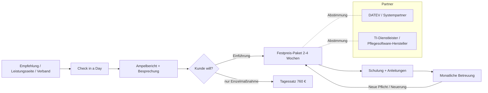

# Productized Service: Pflicht-Digitalisierung in der Branchensoftware

> Entwurf 24.11.2026 · Status: **KONZEPT, lokal, nicht freigegeben** · Gate: Neuberechnung nach 10 Gesprächen je Edition
> Löst als Hauptrichtung [[productized-service-souveraene-ki-iam]] ab (lokale KI-Box widerlegt, siehe [[kundengruppen-positionierung]] Abschnitt 9).
> Alle Preise und Mengen sind **Annahmen**. Quellen und deren Datum stehen in Abschnitt 9 der Kundengruppen-Analyse.

#idee #trace-it #productized-service

## 1. Leitidee

> **„Ich bringe die Pflicht-Digitalisierung in Ihrer Branchensoftware zum Laufen – sicher, geschult, betreut."**

| | Kanzlei-Edition | Pflege-Edition |
|---|---|---|
| Branchensoftware | **DATEV** | **Pflegesoftware + TI** (Konnektor/TI-Gateway, SMC-B, KIM) |
| Aktuelle Pflicht / Neuerung | DATEV Copilot (seit Mai 2026), BStBK-KI-FAQ (Jan 2026), E-Rechnung-Ausstellung ab 01.01.2027 (> 800.000 € Umsatz) | TI-Pflicht seit 07/2025, **Abrechnung SGB XI nur noch elektronisch über die TI ab 01.12.2026** |
| Was der Kunde kauft | Rechtssichere KI-Nutzung + stabile E-Rechnungs-Abläufe | KIM und E-Abrechnung laufen im Alltag, Team ist geschult |
| Wer installiert die Technik? | DATEV / DATEV-Systempartner | TI-Dienstleister / Softwarehersteller |
| **Deine Rolle** | Einführung, Regeln, Schulung, Zugänge, Betreuung | Einführung, Abläufe, Schulung, Zugänge, Betreuung |

**Was gemeinsam bleibt (Technik-Kern):**
- Zugänge und Sicherheit: AD/Entra, GPO, MFA, Checklisten für Ein- und Austritte
- Vorlagen für Schulung und Anleitungen
- Bericht-Generator aus dem AI-OS (intern)

**Lokale KI** gibt es nur noch als Option für Sonderfälle, sie wird nicht beworben.

**Abgrenzung:** keine Steuerberatung (Steuerberatungsgesetz), keine Rechtsberatung, keine TI-Installation, keine Pflegesoftware. Du bist die **Brücke zwischen Hersteller und Team**.

## 2. Kanzlei-Edition: „DATEV-KI & E-Rechnung sicher im Griff"

**Zielgruppe:** DATEV-Steuerkanzleien in Hamburg + Umland, 3–20 Mitarbeitende.
**Positionierungssatz:** Ich helfe DATEV-Kanzleien, KI und E-Rechnung so einzuführen, dass das Team schneller arbeitet – **ohne dass Mandantendaten in ChatGPT landen** und ohne Berufsrechtsrisiko.

| Stufe | Inhalt | Ergebnis | Preis netto (Annahme) |
|---|---|---|---|
| **1. KI- & Zugangs-Check „in a Day"** | Anonyme Kurzumfrage zur KI-Nutzung im Team (Schatten-KI), Status DATEV Copilot und Lizenzen, DATEV-Konto/MFA, Berechtigungen, Austritte der letzten 12 Monate, Stand E-Rechnung | Ampelbericht + Maßnahmenplan + 45-min-Besprechung | 690 € |
| **2. DATEV-KI-Einführung** (4 Wochen) | Copilot aktivieren, Rollen und Rechte; **KI-Nutzungsrichtlinie** als organisatorische Vorlage, angelehnt an das BStBK-FAQ (die Kanzlei verantwortet den Inhalt); öffentliche KI-Dienste per Richtlinie/GPO/Browser-Policy sperren oder steuern; 2 Schulungen à 90 min mit Kanzlei-Beispielen; Vorlagensammlung für Prompts | KI im Team erlaubt, geregelt, dokumentiert | 2.490 € (bis 15 MA) |
| 2a. Zusatz: **E-Rechnung stabil** | Abläufe in der Kanzlei (Eingang, Prüfung, Fehlerfälle), Checkliste für Störungen der DATEV-Plattform, Musteranleitung für Mandanten | Weniger Rückfragen und Hänger | 990 € |
| **3. Kanzlei-IT-Wächter** (monatlich) | Zugangs-Review (Austritte, MFA), Nachpflege der KI-Richtlinie bei DATEV-Neuerungen, 20-min-Quartalsupdate „Was ist neu im Copilot", Ansprechpartner am nächsten Werktag | Bleibt sicher und aktuell | 249 €/Monat, 12 Monate |
| Optional (zu testen) | Mandanten-Digital-Setup E-Rechnung, von der Kanzlei vermittelt | – | 490 € je Mandant |

**Warum nicht austauschbar:** DATEV-Wissen + Zugangsverwaltung/GPO + KI-Einführung + Berufsrecht-Bewusstsein aus einer Hand.
**Konkurrenz (zu prüfen):** DATEV-Systempartner (oft Hardware/Netz), DATEV-eigene Schulungen, KI-Berater ohne DATEV-Tiefe.

## 3. Pflege-Edition: „KIM & E-Abrechnung im Alltag startklar"

**Zielgruppe:** ambulante Pflegedienste in Hamburg + Umland, 10–80 Mitarbeitende, **bereits oder bald an die TI angebunden**.
**Positionierungssatz:** Ich helfe ambulanten Pflegediensten, dass KIM und die elektronische Abrechnung im Alltag wirklich laufen – **ohne dass die Pflegedienstleitung selbst IT machen muss** und ohne Zahlungsausfälle bei den Kassen.

| Stufe | Inhalt | Ergebnis | Preis netto (Annahme) |
|---|---|---|---|
| **1. TI-Alltags-Check „in a Day"** | Status Konnektor/TI-Gateway, SMC-B/eHBA (Laufzeiten), KIM-Adresse und -Postfach, KIM in der Pflegesoftware, Abrechnungsweg ab 01.12.2026, Zugänge/Geräte | Ampelbericht + Maßnahmenplan + Hinweis auf förderfähige Posten (§ 8 Abs. 8 SGB XI, prüfen) | 590 € |
| **2. KIM & E-Abrechnung startklar** (2–3 Wochen) | Abläufe festlegen (wer liest das KIM-Postfach, Vertretung, Fristen); Test-KIM mit Kasse/Arzt; Abstimmung mit TI-Dienstleister und Softwarehersteller; 2 Teamschulungen à 60 min; Kurzanleitungen am Arbeitsplatz; MFA und Austritt-Checkliste | KIM wird genutzt, Abrechnung läuft | 1.990 € |
| **3. TI-Betreuung** (monatlich) | Monatscheck (Zertifikats-Laufzeiten, KIM-Postfach funktioniert), Koordination bei Störungen mit Hersteller/Dienstleister, Ein- und Austritte, Quartalsupdate zu neuen TI-Pflichten (z. B. eVO, ePA) | Keine bösen Überraschungen | 199 €/Monat, 12 Monate |

**Warum nicht austauschbar:** Gesundheitswesen-Erfahrung (Turbomed, NAVIS) + TI-Verständnis + Zugangsverwaltung + Schulung. Installiert haben es andere, **zum Laufen bringst du es**.
**Konkurrenz (zu prüfen):** TI-Dienstleister und Softwarehersteller (installieren, betreuen aber laut Belegen wenig im Alltag), Pflegeberater ohne IT-Tiefe.
**Zeitfenster:** Die Pflicht zur elektronischen Abrechnung ab 01.12.2026 beginnt in einer Woche. Nachzügler-Bedarf ist wahrscheinlich im Dezember 2026 bis Q1 2027. Ob tatsächlich Sanktionen kommen, ist ungeklärt; nicht mit Angst verkaufen.

## 4. Ablauf (beide Editionen)

## 5. Rohschätzung (KEIN Gate-Ergebnis)

Nur zum Vergleich mit dem alten Konzept. Mengen sind geschätzt, Gespräche fehlen.

| Basis, 12 Monate | Menge | Umsatz | Stunden (geschätzt) |
|---|---|---|---|
| Kanzlei-Check | 4 | 2.760 € | 32 h |
| DATEV-KI-Einführung | 3 | 7.470 € | 78 h |
| E-Rechnung stabil | 2 | 1.980 € | 20 h |
| Kanzlei-IT-Wächter | 15 Kundenmonate | 3.735 € | 38 h |
| TI-Alltags-Check | 5 | 2.950 € | 35 h |
| KIM & E-Abrechnung startklar | 4 | 7.960 € | 80 h |
| TI-Betreuung | 20 Kundenmonate | 3.980 € | 40 h |
| Tagessätze | 6 | 4.560 € | 48 h |
| **Summe** | | **≈ 35.400 €** | **≈ 370 h** (≈ 96 €/h) |

Vorteil gegenüber der KI-Box: **kleinere Pakete** (590–2.490 € statt 3.900 € + Hardware), dadurch schnellere Kaufentscheidung, keine Hardware beim Kunden, kein Hardware-Ausfallrisiko. Nachteil: Mehr Kunden nötig, mehr Akquise.

## 6. Prüfen in den ersten 10 Gesprächen je Edition

**Kanzlei:**
1. Nutzt ihr den DATEV Copilot schon? Wer hat ihn eingerichtet?
2. Gibt es eine schriftliche KI-Regel im Team? Wer nutzt privat ChatGPT für die Arbeit?
3. Wo hakt die E-Rechnung gerade – bei euch oder bei Mandanten?
4. Würdet ihr für Einführung + Schulung zum Festpreis zahlen? In welcher Höhe?

**Pflege:**
1. Seid ihr an die TI angebunden? Wer hat installiert?
2. Wer liest das KIM-Postfach, und wie oft?
3. Läuft die elektronische Abrechnung ab 01.12.2026 bei euch?
4. Was fehlt euch: Technik, Schulung oder jemand, der sich kümmert?

**Belege der Zielgruppe sammeln (Regel 6):** DATEV-Community, Pflegeverbände (bpa, Diakonie, Paritätischer Hamburg), LinkedIn-/Facebook-Gruppen von Pflegedienst-Inhabern. Jede Aussage mit Link und Datum notieren.

## 7. Offene Entscheidungen (CEO)
- [ ] Neue Leitidee „Pflicht-Digitalisierung in der Branchensoftware" bestätigen
- [ ] Preise als Startannahme ok?
- [ ] Optionales Mandanten-Setup behalten oder streichen?
- [ ] Danach: Gate neu rechnen (nach den Gesprächen)
