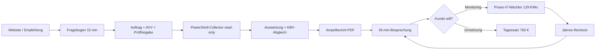

# Productized Service: Praxis-IT-Check (1 Mensch · 1 Lösung · 1 Service)

> **ZURÜCKGESTELLT 24.11.2026** zugunsten [[productized-service-souveraene-ki-iam]] (Praxen = mögliches Folgesegment „Berufsgeheimnisträger").
> Erstellt 24.11.2026 · Status: **KONZEPT** (Gate: [[wirtschaftlichkeit-praxis-it-check]], wartet auf CEO-Freigabe)
> Schärft [[wirtschaftlichkeit-trace-it]] (3 Startangebote) auf **ein** Angebot zu – erfüllt dort Auflage A8 „ein Plan".

#wichtig #idee #trace-it #productized-service

## 1. Bewertung des Ausgangskonzepts (ChatGPT-Entwurf)

| Punkt | Bewertung | Warum |
|---|---|---|
| Productized statt Stundensatz | ✅ richtig | Wiederholbar, skriptbar, passt zu PowerShell/AI-OS-Automatisierung |
| Erfahrung statt KI-SaaS zuerst | ✅ richtig | Deckt sich mit Gate TRACE IT: Geld kommt in Jahr 1 aus Dienstleistung |
| **5 Services + 5 Abos** | ❌ zu breit | 10 Angebote = 10 Leistungsbeschreibungen, 10 Vorlagen, keine Referenz-Story. Für 1 Person nicht vermarktbar |
| **Zielgruppe „KMU + Systemhäuser"** | ❌ unscharf | Kein Grund, warum ein Kunde *dich* statt des Systemhauses um die Ecke nimmt |
| AD-/GPO-Audit als Produkt | ⚠️ technisch gut, schwer verkäuflich | Kleine Betriebe kaufen keinen „AD Health Check" – sie kaufen Ruhe vor Pflicht/Risiko |
| 5.000 €/Monat-Rechnung | ❌ unrealistisch für J1 | Braucht 12 Abo-Kunden + 3 Projekte/Monat; Businessplan J1 liegt bei ≈ 1.660 €/Monat |
| KI-Wissensassistent | ⚠️ später | Haftung/DSGVO, lange Sales-Zyklen – erst Ausbaustufe |
| TRACE-AI-Plattform | ⚠️ später | Erst bauen, wenn ≥ 5 wiederkehrende Kunden denselben Ablauf brauchen |
| Bilder/„Saviynt"-Links | irrelevant | Fremde Markenbilder nicht auf die eigene Website übernehmen |

**Kernproblem:** Das Konzept beschreibt *was du kannst*, nicht *wofür ein konkreter Kunde zahlt*. Dein unfairer Vorteil liegt nicht in „AD", sondern in **AD + Praxis-Software (CGM Turbomed) + Klinik-KIS (NAVIS) + Identity Security** – also im **Gesundheitswesen**.

## 2. Die Zuspitzung

| | Entscheidung |
|---|---|
| **1 Zielgruppe** | Arzt- und Zahnarztpraxen / kleine MVZ (3–25 Arbeitsplätze), Hamburg + remote |
| **1 Problem** | Gesetzliche Pflicht zur IT-Sicherheit (KBV-IT-Sicherheitsrichtlinie, § 390 SGB V) – viele Praxen wissen nicht, ob sie sie erfüllen; Ransomware-Angst; Praxisverwaltungssystem darf nicht ausfallen |
| **1 Lösung** | **Praxis-IT-Check** – Festpreis-Prüfung mit Ampelbericht + Maßnahmenplan |
| **1 Service (wiederkehrend)** | **Praxis-IT-Wächter** – monatlicher automatischer Zustandsbericht + Jahres-Recheck |
| Upsell (kein eigenes Produkt) | Umsetzung der Maßnahmen zum Tagessatz |
| Auslastungs-Ventil | Tagessatz-Projekte (AD/IAM) als Subunternehmer – **nicht beworben**, nur angenommen |

Warum Praxen und nicht „KMU":
- **Pflicht statt Kür** → Kaufanlass existiert schon (Richtlinie, Haftung, Versicherer fragen nach).
- **Du sprichst ihre Sprache** (PVS, TI-Konnektor, Kartenterminals, Datenschutz Art. 9 DSGVO).
- **Kleine Praxen sind für große Systemhäuser unattraktiv**, für dich genau die richtige Größe.
- **Identische Umgebungen** (Windows-Server/AD, PVS, Konnektor) → Prüfskript einmal bauen, 100× nutzen.

## 3. Das Produkt

### Praxis-IT-Check – 790 € netto (Festpreis, bis 15 Arbeitsplätze)
| Baustein | Inhalt |
|---|---|
| Vorab | Fragebogen (15 min), Auftrag + AVV + schriftliche Prüffreigabe |
| Erhebung (≈ 3 h, vor Ort oder remote) | PowerShell-Collector (read-only): AD-Konten/Admins, Passwort-/Sperrrichtlinien, GPOs, Patchstand, Virenschutz, Backup (inkl. Wiederherstellungstest-Nachweis), Freigaben, Firewall, Fernwartungszugänge |
| Abgleich | Anforderungen der KBV-Richtlinie nach Praxisgröße + Basis-Hygiene (BSI-Grundschutz-Light) |
| Ergebnis (5 Werktage) | Ampelbericht (PDF, 1 Seite Management + Detailteil), priorisierte Maßnahmenliste mit Aufwandsschätzung |
| Abschluss | 45 min Besprechung mit Praxisinhaber:in |
| **Nicht enthalten** | Umsetzung, Penetrationstest, Haftung für bestehende Mängel, PVS-Herstellersupport |

Preisstaffel: bis 5 AP **590 €** · bis 15 AP **790 €** · MVZ bis 25 AP **1.190 €**.

### Praxis-IT-Wächter – 129 € netto/Monat (Mindestlaufzeit 12 Monate)
- Monatlicher automatischer Bericht (Sentinel-Pi oder Agent beim Kunden): Backups gelaufen? Patches? Neue Admin-Konten? Virenschutz aktiv? Speicherplatz?
- Quartals-Call 20 min
- **Jährlicher Recheck inklusive** (Wert 790 €) → das ist der Grund, das Abo zu behalten
- Alarm per E-Mail rund um die Uhr, **Reaktion nächster Werktag**, kein 24/7, keine Entstörung (die ist Tagessatz)

### Umsetzung (Upsell)
95 €/h bzw. 760 €/Tag – Paketpreise erst, wenn sich wiederholende Maßnahmen zeigen (z. B. „Backup 3-2-1 einrichten").

## 4. Ablauf (Lieferprozess)

Was automatisiert wird (AI-OS/TRACE): Collector-Skript → JSON → Berichtsgenerator (Vorlage + LLM-Formulierungshilfe lokal, **keine Kundendaten in Cloud-LLMs**).

## 5. Vertriebsweg (Antwort auf A–D)

**Empfehlung: B als Produkt, A nur als Auslastungs-Ventil.** D frühestens ab ≥ 5 Wächter-Kunden.

1. **Bestandsnetzwerk Praxen** – *Achtung:* keine Kunden eines früheren/aktuellen Arbeitgebers aktiv abwerben (Wettbewerbsklauseln prüfen).
2. **Kooperation statt Konkurrenz:** PVS-Händler/kleine Praxis-IT-Betreuer, die keine Sicherheitsprüfung anbieten → du lieferst den Check als White-Label.
3. **Lokale Sichtbarkeit:** eine Leistungsseite auf vuxuantiep.de („IT-Sicherheitsrichtlinie Praxis Hamburg"), Google-Unternehmensprofil, Vortrag/Stammtisch Ärztenetz oder Qualitätszirkel.
4. **Vietnamesische Community** (Ärzt:innen, Zahnärzt:innen) als zweisprachiger Bonus – kein eigenes Produkt.

## 6. Umsatzziel 12 Monate

**Realistisch 2.000 €/Monat im Schnitt von Monat 7–12**, Stretch 3.000 €. 5.000 € ist ein Jahr-2/3-Ziel.
Details, Szenarien und Risiken: [[wirtschaftlichkeit-praxis-it-check]].

## 7. 90-Tage-Plan (angepasst)

| Zeitraum | Ziel | Fertig, wenn |
|---|---|---|
| Tag 1–14 | KBV-Richtlinie (aktuelle Fassung) in Prüfliste übersetzen; Leistungsbeschreibung, AVV, Prüffreigabe | 1 PDF-Angebot verschickbar |
| Tag 15–35 | Collector-Skript (read-only) + Berichtsvorlage; Test im eigenen Lab (Keycloak/AD-Lab) | Musterbericht aus Lab-Daten |
| Tag 20–40 | 10 Gespräche mit Praxen/Praxis-IT-Betreuern | Preis bestätigt oder angepasst |
| Tag 36–60 | **2 bezahlte Pilot-Checks** (darf 490 € sein, Rabatt sichtbar ausweisen) | 2 Rechnungen + 1 Referenzzitat |
| Tag 61–90 | Prozess nachschärfen, Wächter-Abo anbieten, Leistungsseite live | 1 Wächter-Vertrag |

**Abbruch-/Pivot-Kriterium:** Nach Tag 60 keine 2 bezahlten Checks → gleiche Skripte als **„AD-Security-Check" für Systemhäuser** (Vertriebsweg A) anbieten.

## 8. Vor dem ersten Kunden (Pflicht)
- IT-Haftpflicht/Vermögensschaden (Angebot einholen)
- AVV-Vorlage (Gesundheitsdaten im Zugriffsbereich!), Verschwiegenheitserklärung, schriftliche Prüffreigabe
- Leistungsbeschreibung mit Haftungsbegrenzung, „keine Rechtsberatung"
- Prüfen: KBV-Zertifizierung als IT-Dienstleister für Praxen (freiwillig, starkes Vertrauenssignal) – Voraussetzungen und Kosten recherchieren
- Gewerbe/Freiberuf mit Jobcenter abgestimmt (Einstiegsgeld/LES **vor** Start beantragen, siehe A1 TRACE IT)
