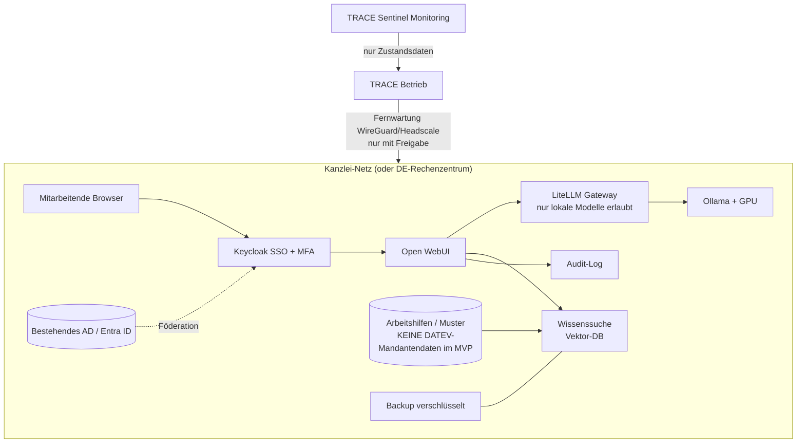

# Productized Service: Souveräne Open-Source-Infrastruktur mit IAM + KI

> Erstellt 24.11.2026 · Status: **KONZEPT** (Gate: [[wirtschaftlichkeit-souveraene-ki-iam]], wartet auf CEO-Freigabe)
> ⛔ **ABGELÖST 24.11.2026** durch [[productized-service-pflicht-digitalisierung]]. Die lokale KI-Box ist durch die Nachprüfung widerlegt (DATEV Copilot, KI in der Pflegesoftware).
> ⚠️ **24.11.2026:** Zielgruppen-Analyse [[kundengruppen-positionierung]] empfiehlt **Pflegedienste statt Steuerkanzleien** als Hauptsegment (Kanzleien = Folgesegment). Entscheidung CEO offen.
> Löst [[productized-service-praxis-it-check]] als Hauptrichtung ab (dort zurückgestellt, Bausteine wiederverwendbar).

#wichtig #idee #trace-it #productized-service #souveränität

## 1. Bewertung der Richtung

**Thema: stark.** Digitale Souveränität ist politisch und wirtschaftlich im Aufwind (openDesk/ZenDiS, Landes-Migrationen weg von US-Clouds, Deutschland-Stack, US-CLOUD-Act-Sorgen, EU AI Act). Und es passt genau zu dem, was du **schon gebaut hast**:

| Baustein | Vorhanden im AI-OS / Lab |
|---|---|
| IAM / SSO / MFA | Keycloak (IAM-Lab), Entra-ID-Lernpfad, Identity-Security-Spur |
| Lokale KI | Ollama, LiteLLM-Gateway, RAG-Pipeline, Datenschutz-Schalter Lokal/Hybrid |
| Betrieb | Docker, Backup-Modul, Monitoring, RAM-Guard, Cloudflare-Tunnel, Tailscale |
| Hardware | VTA-439 + RTX 3090 geplant (LES) → Demo-/Referenzgerät |

**Aber: drei Zielgruppen sind drei Geschäfte.** Für „1 Mensch · 1 Lösung · 1 Service" muss eine Zielgruppe vorne stehen.

| Kriterium (1–5) | Steuerkanzlei | Öffentlicher Sektor | E-Commerce-Händler |
|---|---|---|---|
| Schmerz „Daten dürfen nicht raus" | **5** (Berufsgeheimnis § 203 StGB, § 62a StBerG) | 5 | 2 (Shopify/Cloud ist Normalzustand) |
| Zahlungsbereitschaft | 4 | 4 (aber Haushaltsjahr) | 2 (preissensibel) |
| Kaufentscheidung | **schnell** (Inhaber:in entscheidet) | sehr langsam (Vergabe, Gremien) | schnell |
| Zugang für 1-Personen-Firma | 4 | **1–2** (Referenzen, Rahmenverträge, Eignungsnachweise) | 3 |
| IAM-Bedarf | 3 (Mitarbeiter, Mandantenzugänge) | 5 | 1 |
| Passt zu deiner Erfahrung | 4 (Windows/AD, Fachverfahren) | 5 (E-Akte, Fachverfahren, KIS) | 2 |
| Konkurrenz | DATEV-Ökosystem, Kanzlei-IT-Betreuer | Dataport, große Integratoren | Agenturen, SaaS-Tools |
| **Summe** | **25** | 21–22 | 13 |

**Ergebnis:**
- **Steuerkanzleien = Startmarkt.** Höchster Schmerz bei kurzem Verkaufszyklus.
- **Öffentlicher Sektor = Phase 2, nur als Subunternehmer** (für openDesk-/Keycloak-Integratoren oder Dataport-Partner). Direktvertrieb an Behörden ist für einen Einzelunternehmer im Jahr 1 nicht realistisch.
- **E-Commerce streichen.** Souveränität ist dort kein Kaufgrund, und es verwässert die Botschaft.

Hinweis: Die Kanzlei-Positionierung lässt sich später ohne Umbau auf andere **Berufsgeheimnisträger** (Anwälte, Arztpraxen, siehe zurückgestelltes Praxis-Konzept) übertragen. Gleiche Technik, gleiches Argument.

## 2. Der Vorschlag

**Positionierung:** *„KI in der Kanzlei – ohne dass Mandantendaten die Kanzlei verlassen."*

| | |
|---|---|
| **1 Zielgruppe** | Steuerkanzleien mit 5–30 Mitarbeitenden (Hamburg + remote) |
| **1 Problem** | Mitarbeitende nutzen ChatGPT & Co. heimlich mit Mandantendaten → Verstoß gegen Berufsgeheimnis. Verbieten hilft nicht, die Kanzlei braucht eine erlaubte Alternative |
| **1 Lösung** | **Kanzlei-KI-Box**: souveräner KI-Arbeitsplatz vor Ort (oder in deutschem Rechenzentrum) mit Anmeldung über die bestehenden Kanzlei-Konten |
| **1 Service** | **Box-Betrieb**: Updates, Modellpflege, Backup, Überwachung, Quartals-Call |
| Türöffner | **KI-Datenabfluss-Check** (Festpreis) |

### Leistungsleiter
| Stufe | Inhalt | Preis netto (Annahme) |
|---|---|---|
| 1. KI-Datenabfluss-Check | Welche Cloud-/KI-Dienste werden genutzt, wohin fließen Daten, Konten/MFA-Stand, Schatten-KI. Ergebnis: Ampelbericht + KI-Nutzungsrichtlinie (Vorlage) + Besprechung | **690 €** |
| 2. Kanzlei-KI-Box einrichten | Hardware oder DE-Hosting, Keycloak-SSO (an AD/Entra gekoppelt, MFA), Open WebUI + lokale Modelle, Wissenssuche über interne Arbeitshilfen/Muster, Rollen, Protokollierung, 2 Schulungen à 1 h | **3.900 €** + Hardware zum Einkaufspreis (≈ 2.500–4.500 €) bzw. Hosting |
| 3. Box-Betrieb | Updates, Modell-Wechsel, Backup-Prüfung, Monitoring (Sentinel), Quartals-Call, Reaktion nächster Werktag | **249 €/Monat**, 12 Monate Mindestlaufzeit |
| Extra (Tagessatz) | Neue Anwendungsfälle, Anbindung weiterer Dokumentquellen | 760 €/Tag |

### Was die KI tut – und was nicht
- **Ja:** Mandantenbriefe/E-Mails entwerfen, Bescheide/Schriftverkehr zusammenfassen, interne Arbeitshilfen durchsuchen, Protokolle.
- **Nein:** keine steuerliche Beratung, keine automatische Bearbeitung in DATEV. DATEV wird **ergänzt, nicht ersetzt**.
- Lokale Modelle (≈ 24 GB GPU) sind gut für Text und Zusammenfassung, aber schwächer bei rechtlichem Schlussfolgern → ehrlich so verkaufen.

## 3. Architektur (Kanzlei-KI-Box)

Grundsätze: alles Open Source (Keycloak, Open WebUI, Ollama, LiteLLM, Qdrant/Chroma, Headscale), keine US-Cloud im Datenpfad, Fernwartung nur nach Freigabe und protokolliert.

## 4. Vertrieb
1. **Inhalt statt Kaltakquise:** Leistungsseite + Blogartikel auf vuxuantiep.de („ChatGPT in der Steuerkanzlei – was erlaubt ist"), Live-Demo auf dem eigenen Gerät.
2. **Kanzlei-IT-Betreuer und DATEV-Systempartner als Partner** – sie bieten oft keine lokale KI an. Du lieferst die Box, sie betreuen weiter die übrige IT.
3. **Steuerberaterkammer/-verband Hamburg:** Vortrag oder Webinar zu KI und Berufsgeheimnis.
4. **Vietnamesische Community als Vertrauenskanal** (Empfehlungen), kein Sprach-Produkt – Mandanten sprechen gut Deutsch (Korrektur 24.11.).
5. **Öffentlicher Sektor (ab Monat 9):** gezielt 3–5 openDesk-/Keycloak-Integratoren als Subunternehmer anschreiben; Referenz = eigene Kanzlei-Installationen + Lab.

## 5. 90-Tage-Plan
| Zeitraum | Ziel | Fertig, wenn |
|---|---|---|
| Tag 1–20 | Rechtsrahmen klären (§ 203 StGB, § 62a StBerG, AVV, AI-Act-Kennzeichnung) – ggf. 1 h Fachanwalt | Leistungsbeschreibung + AVV + Haftungsbegrenzung |
| Tag 1–30 | **Demo-Box** im Lab: Keycloak → Open WebUI → Ollama, Musterkanzlei-Daten | 10-min-Demo läuft stabil |
| Tag 20–45 | Check-Vorlage + Ampelbericht + KI-Nutzungsrichtlinie | Musterbericht |
| Tag 30–60 | 10 Gespräche mit Kanzleien/IT-Betreuern | Preis bestätigt |
| Tag 45–75 | **2 bezahlte Checks**, 1 Pilot-Box (Rabatt sichtbar) | Rechnungen + Referenz |
| Tag 75–90 | Betriebsvertrag, Leistungsseite live | 1 Betriebskunde |

**Pivot-Kriterium:** Nach Tag 75 kein bezahlter Check → gleiche Box für **Anwaltskanzleien/Praxen** testen oder als Subunternehmer-Paket (Keycloak/KI-Integration) an Integratoren verkaufen.

## 6. Pflicht vor dem ersten Kunden
- IT-Haftpflicht/Vermögensschaden, AVV, Verpflichtung auf Verschwiegenheit nach § 203 StGB (du wirst „mitwirkende Person")
- Leistungsbeschreibung: keine Steuer-/Rechtsberatung, KI-Antworten sind Entwürfe
- Hardware-Ausfall: Ersatzteil-/Austauschregel, kein 24/7, Wiederherstellung aus Backup ≤ 2 Werktage
- Prüfen: aktuelle DATEV-eigene KI-Angebote (Konkurrenz/Ergänzung?), Förderung „Digital Jetzt"-Nachfolger bzw. Landesprogramme für Kanzleien als Verkaufsargument
